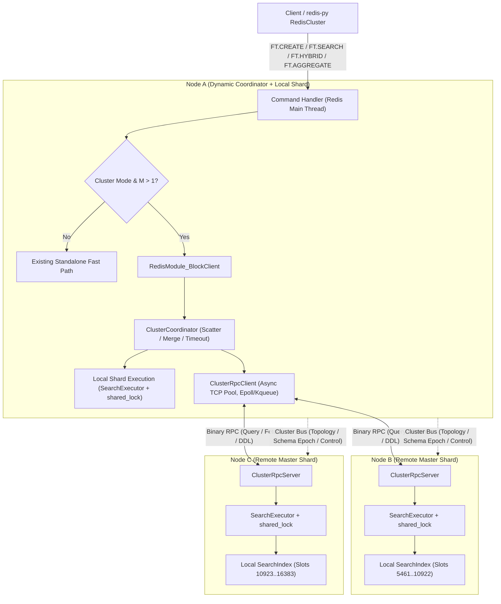
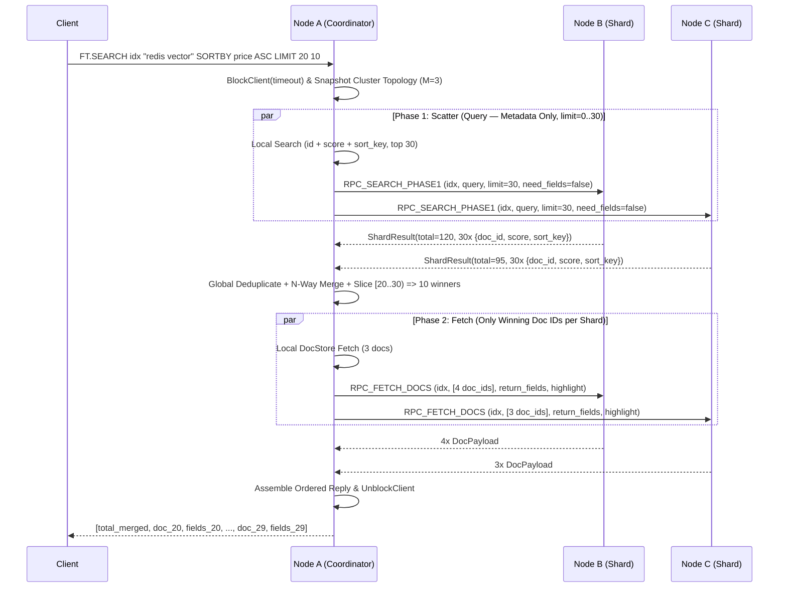

# gemini-search 分布式集群查询（Cluster Scatter-Gather）架构设计报告与 Phase 66–72 演进规划

> **文档状态**：设计提案 / 待审计（RFC）  
> **基线版本**：`main` @ `4b941f9`（已完成 `gemini-search` Phases 0–65）  
> **目标平台**：Redis 7 Cluster（基线 Redis 7.2.11，C++20 Clean-room，离线 Docker CI）  
> **适用范围**：`modules/gemini-search`（`redis_search.so`）与 `ci/cluster_test.py`  
> **Clean-room 声明**：本文档所有架构、协议与分布式算法均严格基于 Redis 7 公开 Module API（`redismodule.h`）、公开命令文档（redis.io）及分布式检索经典理论（Scatter-Gather、Query-Then-Fetch、Map-Reduce 两阶段聚合、Chan 并行方差合并）独立设计，不参考或引用任何 RSALv2/SSPL 源码。

---

## 目录

1. [背景、目标与非目标](#1-背景目标与非目标)
2. [现有代码仓基线盘点与集群化障碍分析](#2-现有代码仓基线盘点与集群化障碍分析)
3. [总体架构设计](#3-总体架构设计)
4. [核心子系统详细设计](#4-核心子系统详细设计)
   - [4.1 集群拓扑发现与分片路由视图](#41-集群拓扑发现与分片路由视图)
   - [4.2 节点间通信层选型与 RPC 协议设计](#42-节点间通信层选型与-rpc-协议设计)
   - [4.3 索引元数据存储、DDL 同步与持久化改造](#43-索引元数据存储ddl-同步与持久化改造)
   - [4.4 `FT.SEARCH` 与向量 KNN / Filtered HNSW Scatter-Gather](#44-ftsearch-与向量-knn--filtered-hnsw-scatter-gather)
   - [4.5 `FT.HYBRID` 全局融合与 BM25 跨分片 IDF](#45-fthybrid-全局融合与-bm25-跨分片-idf)
   - [4.6 `FT.AGGREGATE` 两阶段 Map-Reduce 分布式聚合与游标](#46-ftaggregate-两阶段-map-reduce-分布式聚合与游标)
   - [4.7 全量 `FT.*` 命令集群语义矩阵](#47-全量-ft-命令集群语义矩阵)
   - [4.8 容错、槽位迁移（`MIGRATE`）、安全配额与可观测性](#48-容错槽位迁移migrate安全配额与可观测性)
5. [源码目录规划与跨平台链接隔离](#5-源码目录规划与跨平台链接隔离)
6. [完整 Phase 实施规划（Phases 66–72）](#6-完整-phase-实施规划phases-6672)
7. [风险登记表与缓解策略](#7-风险登记表与缓解策略)
8. [审计检查总表（Audit Sign-off Checklist）](#8-审计检查总表audit-sign-off-checklist)

---

## 1. 背景、目标与非目标

### 1.1 背景与问题定义

截至 Phase 65，`gemini-search` 在单机与主从（Master-Replica `PSYNC`）模式下已具备完整的全文检索（BM25 + WAND）、多模态索引（TEXT/TAG/NUMERIC/VECTOR/GEO/GEOSHAPE）、HNSW 直接 RDB 持久化（`encver 14`）、BQ 两阶段重排（`encver 15`）、自适应 Filtered HNSW、后台增量异步建索引及全路径非阻塞查询卸载能力。

然而在 **Redis Cluster（16384 Hash Slots 多分片架构）** 下，单机二级索引模型面临三个根本问题：

1. **数据分片天然分散**：业务写入 `HSET doc:1 ...` / `JSON.SET doc:2 $ ...` 时，Redis Cluster 按 `CRC16(key) % 16384` 将文档路由到不同 Master 分片；每个节点仅持有约 $1/M$ 的文档（$M$ 为 Master 分片数）。
2. **索引元数据孤立**：在节点 A 执行 `FT.CREATE` 仅在节点 A 创建了内存索引，节点 B/C 无 Schema 且不会订阅相应文档写入。
3. **查询视图残缺**：向任意节点发起 `FT.SEARCH` / `FT.HYBRID` / `FT.AGGREGATE` 只能检索该节点的局部文档，无法获得全局精确的 Top-K、KNN 最近邻、RRF 融合排序或跨分片 `GROUPBY` 聚合结果。

### 1.2 核心设计目标

| 编号 | 目标 | 验收标准 |
|---|---|---|
| **G1** | **客户端完全透明** | 客户端向集群内任意 Master 节点发起 `FT.CREATE` / `FT.DROPINDEX` / `FT.SEARCH` / `FT.HYBRID` / `FT.AGGREGATE` / `FT.INFO`，无需修改客户端路由逻辑，与单机 RESP2/RESP3 返回格式 100% 一致（兼容 `redis-py` `RedisCluster`）。 |
| **G2** | **单机模式零开销与零回退** | 非 Cluster 模式（或单分片 Cluster）下通过 `IsClusterScatterEnabled()` 快速分支，完全走现有单机路径，零额外内存分配与网络开销。 |
| **G3** | **主线程非阻塞** | Coordinator 侧全程基于 `RedisModule_BlockClient` 挂起客户端，网络收发与跨分片归并在独立线程/事件循环中执行；Shard 侧继续复用 `SearchExecutor` 线程池 + per-index `shared_mutex` 并发读，绝不卡死 Redis 事件循环。 |
| **G4** | **结果正确性与可验证性** | 对于 `FT.SEARCH`（`SORTBY` / KNN / Filtered HNSW / `LIMIT 0 0`）、`FT.HYBRID`（全局 RRF/LINEAR）、`FT.AGGREGATE`（可合并 `REDUCE`），在无并发写入的静态快照下，多节点 Cluster 结果与等价单机数据集结果严格一致（浮点误差 $\le 10^{-6}$）。 |
| **G5** | **可审计、可测试、可演进** | 核心编解码、归并排序、Map-Reduce 聚合合并、分布式状态机均放在不依赖 `redismodule.h` 的纯 C++ 核心层，具备 100% GTest + ASan/UBSan 覆盖与多节点 Docker Redis 7.2 Cluster 集成/故障注入测试。 |

### 1.3 显式非目标（Non-Goals）

为控制复杂度并避免过度设计，本设计明确**不包含**以下内容：
- **不支持全局强一致分布式事务（Raft/Paxos 共识）**：Redis Cluster 本身采用最终一致 Gossip 拓扑，DDL 同步采用 Coordinator 协调的两步广播 + Epoch 版本收敛，不引入外部元数据组件（如 etcd/ZooKeeper）。
- **不支持旧版命令 `FT.ADD` / `FT.DEL` 的跨分片路由写**：Redis 7 搜索生态以 `ON HASH` / `ON JSON` 为标准数据写入方式；Cluster 模式下推荐直接通过 `HSET` / `JSON.SET` 写入对应槽位，`FT.ADD` 仅在单机或显式单分片本地模式可用（Cluster 多分片下返回明确错误提示，避免数据与槽位归属错乱）。
- **不支持读副本（Replica）分片 Scatter 路由（首期）**：Phases 66–72 默认向所有健康 `MASTER` 分片下发子查询；面向 Replica 的只读负载分担作为后续可选增强项。
- **不承诺与 RediSearch Enterprise Coordinator 内部协议互通**：遵循 Clean-room 原则，节点间通信采用 `gemini-search` 私有版本化二进制协议。

---

## 2. 现有代码仓基线盘点与集群化障碍分析

### 2.1 可直接复用的现有基建

| 现有组件 | 代码位置 | 集群化中的复用方式 |
|---|---|---|
| 无 Key 命令注册 | `search_commands.cc:85-90` | 全部 32 个 `FT.*` 命令以 `(firstkey=0, lastkey=0, keystep=0)` 注册。在 Redis Cluster 下，无 key 命令**不会触发 `MOVED` / `CROSSSLOT`**，任意节点均可直接接单并充当 Coordinator。 |
| Per-Index 读写锁与异步执行器 | `search_commands.h:53`, `search_executor.h/.cc` | Shard 侧收到远程子查询后，可直接提交至 `GetSearchExecutor()` 并持 `shared_lock(entry.Mutex())` 并发执行，与主线程写入安全互斥。 |
| `RedisModule_BlockClient` 异步框架 | `search_query_cmds.cc`, `search_agg_cmds.cc` | Coordinator 挂起客户端、异步完成全部 RPC 收敛后 `UnblockClient` 回调写回 RESP 回复，沿用成熟模式。 |
| Keyspace 事件与 `MIGRATE` 联动 | `search_keyspace.cc` | 已订阅 `HASH \| GENERIC \| MODULE \| EXPIRED \| EVICTED`（含 `restore` / `del` / `unlink`），槽位迁入/迁出时本地局部索引自动增删。 |
| Redis 7 Cluster Module API | `include/redismodule.h:248-259, 1242-1257` | 已内置 `RedisModule_GetClusterNodesList`、`RedisModule_FreeClusterNodesList`、`RedisModule_GetClusterNodeInfo`、`RedisModule_GetMyClusterID`、`RedisModule_GetClusterSize`、`RedisModule_SendClusterMessage`、`RedisModule_RegisterClusterMessageReceiver`、`RedisModule_ClusterKeySlot`、`RedisModule_ClusterCanonicalKeyNameInSlot`。 |
| 3 节点 Cluster CI 框架 | `ci/cluster_test.py` | 已接入 `ci/run_tests.sh` 并行 Stage 2，可直接扩展加载 `redis_search.so`（及 `redis_json.so`）进行多节点自动化回归。 |

### 2.2 必须解决的 3 个架构级障碍

#### 障碍 1：`GmSearch-` 持久化锚点 Key 的 Slot 归属冲突（高危）

当前单机模式下，`FT.CREATE idx ...` 会在 Redis DB 中创建一个名为 `idx`、类型为 `GmSearch-` 的 key 作为 RDB 持久化锚点（`search_index_cmds.cc`）。在 Redis Cluster 下：
- `CRC16("idx") % 16384` 只属于**某一个** Master 分片。
- 其余 $M - 1$ 个 Master 节点若用相同 key 名写入本地 DB，会产生**不属于本节点槽位的孤儿 key**，触发 `CLUSTER` 一致性异常、无法被 `DUMP`/`SCAN` 正常治理，甚至在 `MIGRATE` 该槽位时意外把整张索引元数据迁走或删除！
- **解法**（详见 §4.3）：Cluster 模式下，各分片的索引元数据与 Phase 62/63 HNSW 图持久化**不再依赖裸 `idx` key**，改为由 `aux_save2` / `aux_load`（或本节点槽位绑定内部 key）管理，彻底解耦索引名与 Hash Slot。

#### 障碍 2：Cluster Bus 与大数据量传输的耦合风险

Redis 7 提供了 `RedisModule_SendClusterMessage` 走 Cluster Bus（`port + 10000`），但 Cluster Bus 同时承载节点间 Gossip 心跳、`PING`/`PONG`、故障检测（`PFAIL`/`FAIL`）与 `FAILOVER` 投票：
- 若通过 Cluster Bus 传输数 MB 的搜索文档或聚合分片结果，会造成 Cluster Bus 写队列阻塞与延迟抖动，极端情况下触发集群误判节点 `PFAIL`。
- **解法**（详见 §4.2）：采用**双平面通信架构**——Cluster Bus 仅用于极轻量的控制信令（如 DDL 广播确认、心跳/拓扑版本通告、或 `< 4 KB` 小控制包），所有查询 Scatter-Gather 数据平面走**独立异步 TCP 二进制 RPC 连接池**（由独立 I/O 线程驱动，彻底隔离 Redis 主线程与 Cluster Bus）。

#### 障碍 3：局部统计与全局语义差异

- **分页放大**：`LIMIT 1000 20` 若让每个分片都回传完整文档体（1020 条 × 文档字段），10 分片即传输 10,200 份完整文档。必须采用 **Query-Then-Fetch 两阶段协议**。
- **聚合不可直接二次合并的 Reducer**：`AVG`、`STDDEV`、`COUNT_DISTINCT`、`QUANTILE`、`FIRST_VALUE`、`RANDOM_SAMPLE` 不能简单把各分片最终输出再算一次，必须在 Map 阶段输出**可结合代数中间态（Partial State）**。
- **BM25 全局 IDF**：分片倾斜时局部 `df(t)/N` 与全局存在偏差，需要提供可选的 2-phase DFS 精确打分开关。

---

## 3. 总体架构设计

### 3.1 逻辑架构图



### 3.2 `FT.SEARCH` Query-Then-Fetch 时序图



---

## 4. 核心子系统详细设计

### 4.1 集群拓扑发现与分片路由视图

#### 4.1.1 拓扑快照结构（`ClusterTopology`）

```cpp
struct ShardNodeInfo {
  std::string node_id;      // 40-byte Redis Cluster node ID
  std::string ip;           // Node IP address
  int redis_port = 0;       // Redis client port
  int rpc_port = 0;         // Search internal RPC port (default: redis_port + offset)
  int flags = 0;            // REDISMODULE_NODE_*
  bool is_myself = false;
  bool is_master = false;
  bool is_healthy = false;  // !(flags & (REDISMODULE_NODE_FAIL | REDISMODULE_NODE_PFAIL))
};

struct ClusterTopology {
  uint64_t version = 0;
  std::string my_node_id;
  std::vector<ShardNodeInfo> masters;  // Sorted by node_id for deterministic ordering
};
```

#### 4.1.2 刷新机制
- **主线程安全采集**：`RedisModule_GetClusterNodesList` / `RedisModule_GetClusterNodeInfo` 只能在 Redis 主线程（或持有 GIL 时）调用。
- 在 `MaintenanceTimerCallback`（现有 1000 ms 定时器）与收到 Cluster Bus 拓扑变更通知时，主线程采集最新 `ClusterTopology`，并通过 `std::atomic<std::shared_ptr<const ClusterTopology>>`（或读写锁保护的不可变快照）发布给后台 Coordinator 线程无锁读取。
- **单机快速判定**：模块加载时通过 `RedisModule_GetContextFlags(ctx) & REDISMODULE_CTX_FLAGS_CLUSTER` 检测是否启用集群模式；若未启用，或 `RedisModule_GetClusterSize() <= 1`，`IsClusterScatterEnabled()` 直接返回 `false`，零额外开销。

---

### 4.2 节点间通信层选型与 RPC 协议设计

#### 4.2.1 方案对比与最终选型

| 维度 | 方案 A：纯 Cluster Bus (`SendClusterMessage`) | 方案 B：Redis Client 协议直连（发内部 `FT._INTERNAL`） | 方案 C（**推荐**）：双平面（Cluster Bus 控制 + 独立二进制 TCP RPC 数据） |
|---|---|---|---|
| Cluster Bus 心跳安全 | 差（大包易引发 `PFAIL` 误判） | 优（独立连接） | **优（数据面彻底隔离）** |
| 序列化性能 | 中（二进制但受限于总线队列） | 差（RESP 文本编码+额外解析开销，且占用远端主线程收包） | **优（零拷贝紧凑二进制 framing，远端由独立 RPC I/O 线程直接投递 `SearchExecutor`）** |
| 远端主线程压力 | 回调在主线程执行，大包拷贝阻塞主线程 | 必须经过远端 Redis 主线程解析命令 | **极低（只读查询全程不经过远端 Redis 主线程！）** |
| 端口与运维配置 | 零额外端口 | 零额外端口（复用 Redis 端口） | 需要配置内部 RPC 端口（默认 `redis_port + 20000`，支持 `--loadmodule ... CLUSTER_RPC_PORT` 覆盖，或自动协商并通过 Cluster Bus 广播） |
| 跨平台测试难度 | 依赖真实 Redis Cluster | 依赖真实 Redis | **纯 POSIX socket / `poll`/`kqueue`/`epoll`，可在 GTest 中用 localhost loopback 独立压测与 ASan/Fuzz 验证** |

> **关键亮点**：方案 C 中，远端分片收到只读子查询（`RPC_SEARCH_PHASE1` / `RPC_FETCH_DOCS` / `RPC_HYBRID_PHASE1` / `RPC_AGG_MAP`）后，**完全不触碰远端 Redis 主线程**，直接由 RPC I/O 线程投递给 `SearchExecutor`，持 `shared_lock(entry.Mutex())` 算完后直接经 socket 回写。这意味着远端分片的 Redis 主线程延迟几乎不受跨节点查询影响！

#### 4.2.2 RPC 端口协商与安全认证
- 节点启动且处于 Cluster 模式时，`ClusterRpcServer` 监听：
  - 默认绑定地址与端口：与 Redis 相同绑定接口，默认端口为 `redis_port + 20000`（若超出 `65535` 或冲突，回退为操作系统分配临时端口，可通过 `FT.CONFIG` / module arg `CLUSTER_RPC_PORT` 显式指定）。
  - 通过 **Cluster Bus 控制消息（`kClusterMsgHello = 0x01`）** 周期性及上线时向全集群广播自己的 `(node_id, rpc_port, schema_epoch, protocol_ver)`，彻底免除手工配置端口映射表。
- **安全校验**：
  - 仅接受来自当前 `ClusterTopology` 已知节点 IP 且帧头 `sender_node_id` 在合法节点表中的连接；
  - 支持可选共享密钥 HMAC-SHA256 握手（`CLUSTER_AUTH_TOKEN`），防止同网段未授权进程向 RPC 端口注入伪造请求。

#### 4.2.3 二进制帧协议设计（`cluster_codec.h/.cc` — 纯 C++ 核心层）

```
+-----------------------------------------------------------------------+
| Magic (4B: "GMSC") | Version (2B: 1) | OpCode (2B) | Flags (2B)       |
+-----------------------------------------------------------------------+
| RequestID (8B)     | PayloadLen (4B, <= kMaxRpcPayload = 32 MiB)      |
+-----------------------------------------------------------------------+
| HeaderCRC32 (4B)   | PayloadCRC32 (4B)                                |
+-----------------------------------------------------------------------+
| Payload Bytes (PayloadLen bytes, little-endian varint / length-prefixed)|
+-----------------------------------------------------------------------+
```

OpCode 枚举：
- `0x0001` `kRpcPing` / `0x8001` `kRpcPong`（健康探活与 RTT 测量）
- `0x0010` `kRpcDdlCreate` / `kRpcDdlDrop` / `kRpcDdlAlter` / `kRpcDdlAlias` / `kRpcDdlSyn` / `kRpcDdlDict`
- `0x0018` `kRpcSchemaSyncReq` / `0x8018` `kRpcSchemaSyncResp`（新节点/重启节点拉取全量 Schema）
- `0x0020` `kRpcSearchPhase1`（元信息查询：返回 `total` + Top-$K$ `{doc_id, score, sort_key}`）
- `0x0021` `kRpcFetchDocs`（按指定 `doc_id` 列表回表取字段 / payload / highlight / summarize）
- `0x0022` `kRpcDfsTermStats`（可选 2-phase BM25 全局 `(N, df)` 统计采集）
- `0x0030` `kRpcHybridPhase1`（返回局部文本 Top-$K_1$ 与局部向量 Top-$K_2$ 原始分数）
- `0x0040` `kRpcAggMap`（下推前置 `FILTER`/`APPLY` + 局部 `GROUPBY` 中间态）
- `0x0050` `kRpcInfoStats` / `kRpcTagVals` / `kRpcSpellCheck`

---

### 4.3 索引元数据存储、DDL 同步与持久化改造

#### 4.3.1 彻底解决 `GmSearch-` 槽位冲突

| 模式 | 元数据与索引持久化位置 | RDB 加载恢复机制 |
|---|---|---|
| **单机 / 主从模式（保持不变）** | 每个索引在 DB 中存 1 个 `GmSearch-` key（`kSearchEncVer = 15`，含 `IndexSpec`、`DocumentStore`、HNSW 图与 BQ 精排向量）+ `aux_save2` 存全局别名/词典/配置。 | 完全沿用现有 `RdbLoadSearch` + `AuxLoadSearch`，100% 向后兼容。 |
| **Cluster 模式（新增 `kSearchAuxEncVer = 2`）** | **不在 DB 中写入裸 `idx` key**，避免跨 slot 冲突与 `MIGRATE` 误迁。改为：<br>1. `aux_save2`（`REDISMODULE_AUX_AFTER_RDB`）写出全量 `IndexSpec`、`synonyms`、Schema Epoch、以及本节点负责文档的 HNSW 预构建图快照（复用 Phase 62/63 `HnswIndex::SerializeGraph`）；<br>2. 实际文档内容由 Redis Cluster 原生 Hash/JSON key 各自持久化在其所属 slot 中。 | 节点重启加载 RDB 时：<br>1. `AuxLoadSearch`（`encver 2`）恢复全部 `IndexSpec`、同义词与 HNSW 图快照；<br>2. `REDISMODULE_EVENT_LOADING_ENDED` 触发本分片扫描本地 Hash/JSON key 补齐倒排索引（若 RDB 持久化了紧凑文档索引快照则线性加载，无需重建 HNSW 图）。 |

> **审计关注点**：为什么选择 `aux_save2` 而不是“用 `ClusterCanonicalKeyNameInSlot` 找本节点某个 slot 存隐形 key”？
> 因为如果管理员后续执行 `CLUSTER RESHARD` 把那个恰好被选中的 slot 迁走，隐形 key 会被一并迁走或删除，导致本节点重启后索引元数据丢失。而 `aux_save2` 绑定的是**节点级 RDB 文件全局段**，与任意单个 Hash Slot 完全解耦，彻底免疫 `RESHARD`/`MIGRATE`。

#### 4.3.2 DDL 两步广播协议（`FT.CREATE` / `FT.DROPINDEX` / `FT.ALTER`）

1. **前置校验**：Coordinator 解析并校验完整命令参数与 Schema 合法性；检查是否已存在同名索引（`FT.CREATE`）或不存在（`FT.DROPINDEX`）。
2. **递增 Schema Epoch**：生成全局单调版本 `(epoch_ms, coordinator_node_id)`，防并发 DDL 覆盖。
3. **两步执行**：
   - **Step 1（Prepare & Apply）**：Coordinator 通过 RPC 并行向所有其他 Master 发送 DDL 请求（携带原始规范化参数与 `epoch`），同时本地执行（`FT.CREATE` 触发 Phase 64 后台增量异步扫描本地 keyspace）。
   - **Step 2（Commit / Compensate）**：
     - 全部 Master 返回 `OK` → 向客户端返回 `OK`，并通过 Cluster Bus 广播最新 `schema_epoch` 摘要；
     - 任一 Master 返回失败（如参数冲突或超时）→ 对已创建成功的分片自动下发补偿回滚（如 `FT.DROPINDEX`），并向客户端返回明确错误（携带失败节点 ID 与原因）。
4. **节点重启 / 新扩容分片自愈**：
   - 新节点加入集群或重启上线时，通过 Cluster Bus 收到其他 Master 广播的 `schema_epoch` 摘要；若发现本地缺少某些索引或版本落后，立即向高版本 Master 发起 `kRpcSchemaSyncReq` 拉取全量 `IndexSpec` / 别名 / 同义词 / 词典，在本地创建索引并自动触发 Phase 64 后台增量扫描本节点存量 key。

---

### 4.4 `FT.SEARCH` 与向量 KNN / Filtered HNSW Scatter-Gather

#### 4.4.1 查询分类与执行策略

| 查询形态 | Phase 1 Scatter 策略 | Merge 策略 | Phase 2 Fetch |
|---|---|---|---|
| `LIMIT 0 0`（纯计数） | 各分片仅返回 `total_hits`（8 字节），不排序不取文档 | `global_total = sum(shard_totals)` | **跳过** |
| `NOCONTENT` | 各分片返回 `LIMIT 0 (offset + count)` 的 `(doc_id, score, sort_key)` | 按 `doc_id` 去重 + 堆归并 + 截断 `[offset, offset + count)` | **跳过** |
| 常规全文 / `SORTBY` | 各分片返回 `LIMIT 0 (offset + count)` 的 `(doc_id, score, sort_key)`；若含 `WITHSCORES`/`EXPLAINSCORE` 一并附带 | 去重 + 堆归并（稳定性 tie-break：按 `doc_id` 字典序）+ 截断 | 按归属 `shard_id` 分组，仅向命中最终 `count` 条文档的分片批量回表拉取 `RETURN` 字段 / `PAYLOAD` / `HIGHLIGHT` / `SUMMARIZE` |
| 向量 KNN / Filtered HNSW | 每个分片独立执行 `KnnQuery(K)` 或 Phase 65 `KnnQueryFiltered(K)`（带 `EF_RUNTIME` / `OVERSAMPLE`） | 按向量距离升序归并取全局 Top-$K$，再应用外层 `LIMIT` | 仅对最终命中的文档执行 Phase 2 回表 |
| `VECTOR_RANGE` | 各分片返回满足 `dist <= radius` 的候选（受 `offset + count` 上限裁剪） | 按距离或 `SORTBY` 归并截断 | 仅对最终命中文档回表 |

#### 4.4.2 数学正确性证明（KNN & `LIMIT offset count`）
- **Top-K 单调性**：设全局按序排列的前 $L = \text{offset} + \text{count}$ 条文档集合为 $G_L$，每个分片 $i$ 的局部前 $L$ 条文档为 $S_{i, L}$。由于全局排序关系（`SORTBY` 字段值、向量距离、或确定性 BM25 分数）在分片内保持同构，任意 $x \in G_L$ 在其所属分片 $i$ 中的排名必然 $\le L$，故必有：
  $$G_L \subseteq \bigcup_{i=1}^{M} S_{i, L}$$
- **去重与稳定性**：若因并发 `MIGRATE` 导致同一 `doc_id` 同时出现在两个分片回包中，归并器维护 `std::unordered_set<std::string_view>` 去重（保留最新/有效分片副本），同时调整 `global_total` 扣除重复计数。

#### 4.4.3 深度分页保护
- 配置项 `CLUSTER_MAX_SCATTER_LIMIT`（默认 `10000`，受现有 `MAXSEARCHRESULTS` 共同约束）：当 `offset + count > CLUSTER_MAX_SCATTER_LIMIT` 时拒绝或截断，防止单次深度分页放大打爆 Coordinator 内存。

---

### 4.5 `FT.HYBRID` 全局融合与 BM25 跨分片 IDF

#### 4.5.1 `FT.HYBRID` 全局精确融合
`FT.HYBRID` 的核心是 `RRF`（Reciprocal Rank Fusion：$\sum \frac{w_r}{c + \text{rank}_r}$）或 `LINEAR`（$\sum w_r \cdot \text{norm\_score}_r$）融合。
- **反模式（错误做法）**：让每个分片各自算局部 RRF 后再合并——因为局部第 1 名在全局可能只是第 20 名，局部排名直接算 RRF 会严重扭曲融合结果。
- **正确设计（全局 RRF / LINEAR）**：
  1. Phase 1 Scatter 下发文本子查询（取局部 Top-$L_{\text{text}}$）和向量子查询（取局部 Top-$L_{\text{vec}}$），各分片分别返回两路**原始未融合列表**（`(doc_id, bm25_score)` 与 `(doc_id, vec_dist)`）；
  2. Coordinator 先对文本路做全局 $M$-way 归并得到全局文本排名，对向量路做全局 $M$-way 归并得到全局向量距离/排名；
  3. Coordinator 复用现有 `hybrid_fusion.h/.cc` 在全局结果上执行 `RRF` / `LINEAR` 融合与 `LIMIT` 截断；
  4. Phase 2 仅对最终 Top-K 命中文档按分片回表取内容。

#### 4.5.2 BM25 跨分片全局 IDF（可选 2-Phase DFS 模式）
- **默认模式（1-Phase 近似 IDF）**：当文档按随机 ID 均匀分布时，各分片内 $df_i(t) / N_i \approx df_{\text{global}}(t) / N_{\text{global}}$，直接一轮 Phase 1 即可获得高精排序与最低延迟。
- **精确模式（2-Phase DFS，`FT.CONFIG SET CLUSTER_BM25_DFS 1` 或查询级扩展）**：
  - Phase 0（极轻量 `kRpcDfsTermStats`）：提取 AST 中全部文本检索词，向各分片收集本地 `(N_i, avgdl_i, df_i(t))`；
  - Coordinator 汇总全局 $N = \sum N_i$、$\text{avgdl} = \frac{\sum N_i \cdot \text{avgdl}_i}{N}$、$df(t) = \sum df_i(t)$；
  - Phase 1 下发查询时附带全局统计覆盖表，各分片用全局 `(N, avgdl, df(t))` 计算 BM25，使跨分片打分与单机 **100% 位级等价**。

---

### 4.6 `FT.AGGREGATE` 两阶段 Map-Reduce 分布式聚合与游标

#### 4.6.1 Pipeline 拆分规则（Map 下推 vs Reduce 上收）

一条 `FT.AGGREGATE` 管道通常形如：
```
QUERY -> [LOAD] -> [Pre-APPLY / Pre-FILTER] -> GROUPBY + REDUCE -> [Post-APPLY / Post-FILTER] -> [SORTBY] -> [LIMIT]
```

Coordinator 的分布式查询计划器（`ClusterAggPlanner`）按以下规则拆分：
1. **无 `GROUPBY` 的纯投影/过滤/排序聚合**：
   - 将 `LOAD`、`APPLY`、`FILTER`、`SORTBY` 全部下推至各分片执行（每分片取 `LIMIT 0 (offset + count)`）；
   - Coordinator 做全局 $M$-way 归并排序并截断 `LIMIT`。
2. **包含单个 `GROUPBY` 的聚合（覆盖 95%+ 生产分析场景）**：
   - **Map 阶段（分片侧）**：执行 `QUERY`、前置 `APPLY`/`FILTER`，以及第一个 `GROUPBY` 的**部分聚合（Partial Reduce）**，按 group key 输出紧凑中间态；
   - **Reduce 阶段（Coordinator 侧）**：合并各分片同 group key 的中间态，产出最终聚合值，然后在 Coordinator 本地继续执行后续所有 `APPLY`、`FILTER`、`SORTBY`、`LIMIT`（以及多级 `GROUPBY`）。

#### 4.6.2 全部 12 个 `REDUCE` 函数的分布式中间态与合并公式

本仓库 `search_agg_cmds.cc` 当前支持全部 12 个 `REDUCE` 函数，逐一定义其 Map-Reduce 语义：

| Reducer | Map 中间态（分片输出） | Reduce 合并公式（Coordinator） | 精确度 |
|---|---|---|---|
| `COUNT` | `uint64_t count` | $\sum c_i$ | 精确 |
| `SUM` | `double sum` | $\sum s_i$ | 精确 |
| `MIN` | `double min`（或 `bool has_val`） | $\min_i m_i$ | 精确 |
| `MAX` | `double max`（或 `bool has_val`） | $\max_i M_i$ | 精确 |
| `AVG` | `(double sum, uint64_t count)` | $\frac{\sum s_i}{\sum c_i}$ | 精确 |
| `STDDEV` | Chan 并行统计三元组 `(uint64_t n, double mean, double M2)` | 逐分片合并：$\delta = \mu_B - \mu_A,\; n = n_A + n_B,\; \mu = \mu_A + \delta \frac{n_B}{n},\; M_2 = M_{2,A} + M_{2,B} + \delta^2 \frac{n_A n_B}{n}$，最终 $\sqrt{M_2 / (n - 1)}$ | 精确（数值稳定） |
| `COUNT_DISTINCT` | `std::vector<std::string>`（受单 group 上限保护） | 集合并集取基数 | 精确 |
| `COUNT_DISTINCTISH` | HyperLogLog 寄存器（16 KB 固定大小，可无损按字节取 `max` 合并） | `HLL_MERGE`（逐寄存器取最大值）后估算基数 | 近似（标准误 ~0.81%） |
| `TOLIST` | 去重后的元素列表 | 合并去重 | 精确 |
| `FIRST_VALUE` | 带排序键的局部最优值 `(sort_key, value)` | 按 `BY <field> ASC\|DESC` 在各分片极值中取全局最优 | 精确 |
| `QUANTILE` | 紧凑分片 T-Digest 质心列表（可复用/借鉴 `gemini-bloom` T-Digest 算法）或有序样本 | 合并质心后求分位数 | 高精度近似（尾分位误差 < 1%） |
| `RANDOM_SAMPLE` | 水塘抽样结果 `(sample[k], total_seen_n_i)` | 加权合并抽样（按 $n_i / \sum n_j$ 概率重采样 $k$ 个） | 统计学无偏 |

#### 4.6.3 集群游标（`FT.AGGREGATE ... WITHCURSOR` + `FT.CURSOR`）
- **Coordinator 托管游标**：`FT.AGGREGATE ... WITHCURSOR` 在 Coordinator 完成跨分片聚合后，将结果集缓存在 Coordinator 的 `GetCursors()` 中（受 `kMaxCursorsPerIndex` 与 `MAXIDLE` 约束），同时在 `cursor_id` 高位编码 `coordinator_node_hash`。
- 若客户端后续 `FT.CURSOR READ` 发到同一节点，直接本地读取；若被集群客户端负载均衡发到其他节点，收到请求的节点根据 `cursor_id` 定位原 Coordinator 并透明代理转发（或返回可路由提示），保证游标读取无缝兼容。

---

### 4.7 全量 `FT.*` 命令集群语义矩阵

逐一审计 `search_commands.cc` 注册的全部 32 个命令在 Cluster 模式下的行为：

| 类别 | 命令 | Cluster 行为 | 实现 Phase |
|---|---|---|---|
| **索引 DDL** | `FT.CREATE`, `FT.DROPINDEX`, `FT.ALTER` | Coordinator 两步广播到全部 Master；`FT.DROPINDEX DD` 同时各分片删除各自本地匹配文档 | P67 |
| **别名 / 同义词 / 词典** | `FT.ALIASADD/UPDATE/DEL`, `FT.SYNUPDATE`, `FT.DICTADD/DEL` | Coordinator 广播到全部 Master 并递增 Schema Epoch | P67 |
| **只读元数据** | `FT._LIST`, `FT.SYNDUMP`, `FT.DICTDUMP`, `FT.EXPLAIN`, `FT.EXPLAINCLI` | 任意节点本地元数据直接回答（依赖 P67 元数据同步保证全集群一致） | P67 |
| **集群统计 / 词表** | `FT.INFO` | Scatter 汇总全部分片：`num_docs`/`num_terms`/`num_records`/内存指标求和；`indexing` 取逻辑 OR；`percent_indexed` 按 key 数加权平均；附带分片级汇总信息 | P69 |
| | `FT.TAGVALS`, `FT.SPELLCHECK` | Scatter 收集各分片结果，Coordinator 去重/按全局词频归并排序 | P69 |
| **核心查询** | `FT.SEARCH` | Query-Then-Fetch 两阶段 Scatter-Gather（含全文、过滤、排序、KNN、Filtered HNSW、`VECTOR_RANGE`） | P68 |
| | `FT.HYBRID` | 全局两路 Scatter-Gather + Coordinator 精确 RRF/LINEAR 融合 + Phase 2 Fetch | P69 |
| | `FT.AGGREGATE`, `FT.CURSOR` | 两阶段 Map-Reduce 分布式聚合 + Coordinator 托管游标 | P70 |
| **性能剖析** | `FT.PROFILE` | 展示 Coordinator 总耗时、Scatter RPC 耗时、Merge 耗时以及各分片执行明细 | P69/P70 |
| **自动补全** | `FT.SUGADD`, `FT.SUGDEL`, `FT.SUGGET`, `FT.SUGLEN` | `SUGADD`/`SUGDEL` 按 `CRC16(dict_key)` 归属槽位路由或广播（推荐按 dict 归属槽位单点转发，避免重复写入），`SUGGET`/`SUGLEN` 透明转发至归属节点 | P69 |
| **配置与调试** | `FT.CONFIG`, `FT._DEBUG` | `FT.CONFIG GET/SET` 默认作用本节点（新增 `CLUSTER_*` 系列配置项）；`FT._DEBUG CLUSTER` 输出当前拓扑、Schema Epoch 与 RPC 连接池指标 | P66/P71 |
| **遗留写入** | `FT.ADD`, `FT.DEL` | 单机模式保持兼容；Cluster 多分片下返回 `ERR FT.ADD/FT.DEL not supported in cluster mode, use HSET/JSON.SET`（避免破坏槽位归属） | P67 |

---

### 4.8 容错、槽位迁移（`MIGRATE`）、安全配额与可观测性

#### 4.8.1 超时与部分失败策略（对齐 `FT.CONFIG ON_TIMEOUT`）
- 每个跨分片请求携带剩余时间预算 `remaining_timeout_ms`（从 Coordinator 接单时刻起算，扣除网络 RTT 裕量后下发给分片）。
- 若某个分片在超时前未返回或连接断开：
  - `ON_TIMEOUT = FAIL`（默认，严格模式）：立即向客户端返回 `ERR cluster shard timeout/unreachable (<node_id>)`，绝不静默返回残缺数据。
  - `ON_TIMEOUT = RETURN`（降级模式）：使用已成功返回的分片结果执行归并，并在日志/监控计数器中递增 `cluster_partial_results_total`。

#### 4.8.2 `CLUSTER RESHARD` / 实时 `MIGRATE` 一致性
- **迁入（`RESTORE`）**：目标节点触发 Keyspace `restore` 事件，自动调用 `IndexHashKey` / `IndexJsonKey` 加入本地索引。
- **迁出（`DEL`）**：源节点在迁移完成删除原 key 时触发 Keyspace `del` 事件，自动调用 `RemoveDocFromIndices`。
- **短暂双写窗口去重**：在源节点尚未删除、目标节点已恢复的毫秒级窗口内，同一 `doc_id` 可能被两个分片同时返回；Coordinator 的归并器在 Phase 1 强制按 `doc_id` 去重，确保客户端绝不会看到重复文档。

#### 4.8.3 节点故障与主从切换（Failover）
- Coordinator 在每次请求开始时读取最新 `ClusterTopology` 快照，**仅向状态健康的 `MASTER`（`REDISMODULE_NODE_MASTER` 且无 `FAIL`/`PFAIL`）下发请求**。
- 当某旧 Master 宕机、Replica 晋升为新 Master 后：
  - Redis Cluster Gossip 更新拓扑；
  - 新 Master 原本已通过 `PSYNC` 完整同步了原 Master 的数据和索引（含 `aux_save2`），上线即可承接本地索引与 RPC 查询；
  - Coordinator 刷新拓扑后自动切换连接池目标到新 Master，并清理失效旧连接。

#### 4.8.4 安全配额与防御边界（防 DoS / OOM / 畸形包）
- `kMaxRpcPayloadBytes = 32 MiB`：单帧超限立即断连拒绝。
- `kMaxClusterFanout = 256`：最大支持分片数上限校验。
- `CLUSTER_MAX_SCATTER_LIMIT = 10000`：单次 `offset + count` 上限保护。
- `CLUSTER_AGG_MAX_GROUPS = 100000`：单分片 Map 阶段最大 group 数保护，防高基数字段打爆 Coordinator 内存。
- 所有反序列化字段（字符串长度、数组个数、CRC32、枚举范围、NaN/Inf）均执行与 `search_rdb.cc` 同等严格的边界检查，配合逐字节截断/篡改 Fuzz 测试验证。

#### 4.8.5 新增 `FT.CONFIG` 参数与监控指标

| 配置项 | 默认值 | 说明 |
|---|---|---|
| `CLUSTER_ENABLED` | `1`（自动检测） | 设为 `0` 可在 Cluster 节点上强制降级为仅查本机（用于运维排查） |
| `CLUSTER_RPC_PORT_OFFSET` | `20000` | 默认内部 RPC 端口偏移（`redis_port + offset`） |
| `CLUSTER_QUERY_TIMEOUT_MS` | `5000` | 跨分片查询默认超时（单条查询 `TIMEOUT` 优先） |
| `CLUSTER_MAX_SCATTER_LIMIT` | `10000` | 单次跨分片查询允许的最大 `offset + count` |
| `CLUSTER_BM25_DFS` | `0` | 是否启用 2-Phase 全局精确 IDF 打分（`0`=单轮快速，`1`=全局精确） |
| `CLUSTER_AGG_MAX_GROUPS` | `100000` | 分布式 `FT.AGGREGATE` Map 阶段每分片最大分组数 |

---

## 5. 源码目录规划与跨平台链接隔离

严格遵守 `CLAUDE.md` 规则 2：**纯算法与协议编解码层绝不 include `redismodule.h`**，确保 macOS 与 Linux GNU ld 下所有 GTest 二进制均可独立链接并跑通 ASan/UBSan。

```
modules/gemini-search/
  src/
    # ── 新增纯算法 / 协议 / 归并核心层（严禁 include redismodule.h）──
    cluster_codec.h/.cc         # 二进制帧协议（CRC32、Varint、DDL/Search/Hybrid/Agg 序列化与严格校验）
    cluster_merger.h/.cc        # N-way 堆归并、doc_id 去重、Query-Then-Fetch 调度、全局 RRF/LINEAR 适配
    cluster_agg_reduce.h/.cc    # 12 种 Reducer 的 Map 中间态数据结构与 Reduce 合并算法（含 Chan 方差合并）
    cluster_rpc.h/.cc           # 轻量异步 TCP RPC Server / Client 连接池（基于 poll/kqueue/epoll，支持 loopback 单测）

    # ── 新增 Redis Module 桥接层（仅编译进 redis_search.so）──
    cluster_topology.h/.cc      # 封装 RedisModule_GetClusterNodesList/Info、Cluster Bus Hello/Epoch 广播
    cluster_coordinator.h/.cc   # Coordinator 请求状态机、BlockClient 桥接、DDL 广播、Shard RPC Handler 绑定

    # ── 改造现有文件（最小侵入）──
    search_commands.h/.cc       # 注册 Cluster Bus Receiver、启停 ClusterRpcServer、MaintenanceTimer 拓扑刷新
    search_index_cmds.cc        # FT.CREATE/DROPINDEX/ALTER/ALIAS* 接入 DDL Coordinator；Cluster 下禁用裸 idx key
    search_query_cmds.cc        # FT.SEARCH / FT.HYBRID 入口增加 Cluster Scatter-Gather 分发
    search_agg_cmds.cc          # FT.AGGREGATE / FT.CURSOR 接入两阶段 Map-Reduce 与 Coordinator 游标
    search_rdb.h/.cc            # kSearchAuxEncVer 升级至 2，支持 Cluster 模式 aux_save2 持久化 IndexSpec + HNSW 图

  tests/
    cluster_codec_test.cc       # 协议往返 + 逐字节截断/篡改/CRC 损坏 Fuzz 测试
    cluster_merger_test.cc      # N-way 归并、去重、分页、KNN、全局 RRF、2-Phase DFS 正确性单测
    cluster_agg_reduce_test.cc  # 全部 12 种 Reducer 分片合并 vs 单机全量等价性单测（含随机切分对拍）
    cluster_rpc_test.cc         # 多线程 loopback RPC 并发收发、超时、断连重连、背压 ASan 测试
```

---

## 6. 完整 Phase 实施规划（Phases 66–72）

### 6.1 Phase 总览路线图

| Phase | 主题 | 核心交付 | 主要验收门禁 |
|---|---|---|---|
| **Phase 66** | **集群基础设施、二进制 RPC 与拓扑发现** | `cluster_codec`、`cluster_rpc`、`cluster_topology`、`FT._DEBUG CLUSTER`、单机零开销判定 | 4 套新 GTest + ASan/UBSan 零泄漏；3 节点 Cluster 自动完成 RPC 端口发现与 `PING`/`PONG` 连通 |
| **Phase 67** | **Cluster 元数据模型、DDL 广播与 `aux_save2` 持久化** | `FT.CREATE`/`DROPINDEX`/`ALTER`/`ALIAS*`/`SYNUPDATE`/`DICT*` 两步广播、Schema Epoch、`kSearchAuxEncVer = 2`、节点重启自愈 | 3 节点 Cluster 任意节点 DDL 同步、失败回滚、单节点重启 `BGSAVE` 恢复 + 扩容新分片自动拉取 Schema |
| **Phase 68** | **`FT.SEARCH` Query-Then-Fetch 与向量 KNN / Filtered HNSW 分布式检索** | `cluster_merger`、Phase 1 元信息 Scatter + Phase 2 回表 Fetch、全文/过滤/`SORTBY`/KNN/Filtered HNSW/`VECTOR_RANGE`/`LIMIT 0 0` | 3 节点 Cluster vs 等价单机结果 **100% 黄金对拍**（含 `ON HASH` + `ON JSON`、`HIGHLIGHT`/`SUMMARIZE`、`redis-py` `RedisCluster`） |
| **Phase 69** | **`FT.HYBRID` 全局融合、BM25 DFS 精确打分与辅助命令集群化** | `FT.HYBRID` 全局 RRF/LINEAR、可选 `CLUSTER_BM25_DFS`、`FT.INFO`/`FT.TAGVALS`/`FT.SPELLCHECK`/`FT.SUG*`/`FT.PROFILE` 集群语义 | 全局 RRF & DFS BM25 与单机得分误差 $\le 10^{-6}$；`FT.INFO` 全集群文档数/内存/后台建索引进度聚合准确 |
| **Phase 70** | **`FT.AGGREGATE` 两阶段 Map-Reduce 与集群游标** | `cluster_agg_reduce`（全部 12 个 Reducer）、`ClusterAggPlanner` 管道拆分、`FT.CURSOR` Coordinator 托管与跨节点转发 | 随机分片对拍测试：全部 12 个 Reducer 在 3 分片聚合结果与单机完全等价；游标跨节点读取与 `MAXIDLE` 过期回收 |
| **Phase 71** | **弹性容错、`MIGRATE` 一致性、主从切换与安全加固** | `MIGRATE` 实时去重、Master 宕机/Replica Failover 自动重路由、`ON_TIMEOUT FAIL\|RETURN`、配额限流与协议安全校验 | 实时 `RESHARD` 迁移期间持续查询零重复/零崩溃；杀掉 1 个 Master 节点验证故障语义与 Failover 后自动恢复 |
| **Phase 72** | **大规模验证、性能基准、Soak 长稳与文档收口** | 扩展 `ci/cluster_test.py`、新增 `ci/search_cluster_soak_test.py`、集群 QPS/P99 基准、更新 `DESIGN.md`/`README.md`/`CHANGELOG.md` | Docker Redis 7.2.11 全量并行 CI 全绿（含 3 节点 Search Cluster + Cluster Soak）、完整审计签收 |

---

### 6.2 各 Phase 详细设计与审计检查点

#### Phase 66：集群基础设施、二进制 RPC 与拓扑发现
- **详细任务**：
  1. 实现 `cluster_codec.h/.cc`：帧头定义、CRC32 校验、小端序列化/反序列化读写器（带严格长度与上限检查，禁止未校验分配）。
  2. 实现 `cluster_rpc.h/.cc`：独立 I/O 线程的异步非阻塞 TCP Server 与按 `node_id` 复用的 Client 连接池（支持单连接多路复用 `request_id`、按请求超时取消、连接断开快速失败回调）。
  3. 实现 `cluster_topology.h/.cc`：封装 `RedisModule_GetClusterNodesList` / `GetClusterNodeInfo` / `GetMyClusterID` / `GetClusterSize`，通过 Cluster Bus（`kClusterMsgHello`）互相通告 `rpc_port` 与 `schema_epoch`。
  4. 新增 `FT.CONFIG` 集群参数注册与 `FT._DEBUG CLUSTER` 诊断命令（输出节点列表、Master 状态、已发现的 `rpc_port`、活跃连接数）。
- **测试与审计检查点**：
  - `cluster_codec_test`（GTest + ASan/UBSan）：全 OpCode 往返测试 + 10,000 次随机截断/位翻转 Fuzz 零崩溃。
  - `cluster_rpc_test`（GTest + ASan/UBSan）：1000 并发请求、超时清理、对端强杀断连重连、超大包（> 32 MiB）拒绝。
  - 3 节点 Cluster 启动后 1 秒内所有节点互知对方 `rpc_port`，单机模式 `FT._DEBUG CLUSTER` 显示 `standalone`，不启动监听端口。

#### Phase 67：Cluster 元数据模型、DDL 广播与 `aux_save2` 持久化
- **详细任务**：
  1. 改造 `search_index_cmds.cc`：Cluster 模式下 `FT.CREATE` / `FT.DROPINDEX` / `FT.ALTER` / `FT.ALIAS*` / `FT.SYNUPDATE` / `FT.DICT*` 走 `ClusterCoordinator::BroadcastDdl`，并取消在 DB 中写裸 `idx` key。
  2. 升级 `search_rdb.h/.cc` 的 `kSearchAuxEncVer` 至 `2`（向下兼容 `encver 1`）：Cluster 模式下在 `AuxSaveSearch` 中持久化全部 `IndexSpec`、同义词、Schema Epoch 与 HNSW 预构建图块；在 `OnLoadingEvent(LOADING_ENDED)` 恢复本地局部索引。
  3. 实现 `kRpcSchemaSyncReq/Resp`：当新节点加入或落后节点发现高版本 `schema_epoch` 时自动同步全量 Schema 并触发 Phase 64 后台增量扫描。
  4. Cluster 多分片下对 `FT.ADD` / `FT.DEL` 返回明确错误。
- **测试与审计检查点**：
  - 向节点 1 发 `FT.CREATE` 后，节点 2/3 立即可见 `FT._LIST` 且自动索引各自存量 Hash/JSON key。
  - 模拟节点 3 拒绝创建（如已存在冲突），验证节点 1/2 自动回滚，集群无残留脏索引。
  - 重启节点 2（`BGSAVE` + 重启）与动态加入第 4 节点，验证 Schema 与本地索引完整自愈。

#### Phase 68：`FT.SEARCH` Query-Then-Fetch 与向量 KNN / Filtered HNSW 分布式检索
- **详细任务**：
  1. 实现 `cluster_merger.h/.cc`：通用 $M$-way 归并堆（支持 BM25 降序、`SORTBY` 数值/字符串升降序、向量距离升序）、`doc_id` 确定性去重与 `LIMIT offset count` 切片。
  2. 实现 `kRpcSearchPhase1` 与 `kRpcFetchDocs` 编解码及 Shard 侧无主线程执行路径（RPC 线程 → `SearchExecutor` → `shared_lock` → 回包）。
  3. 在 `search_query_cmds.cc` 接入 Coordinator 异步状态机（`RedisModule_BlockClient`），覆盖：`LIMIT 0 0`、`NOCONTENT`、`WITHSCORES`、`WITHPAYLOADS`、`WITHSORTKEYS`、`EXPLAINSCORE`、`RETURN`、`HIGHLIGHT`、`SUMMARIZE`、`SORTBY`、`FILTER`、`GEOFILTER`、KNN（FLAT/HNSW/SQ8/BQ+Rerank）、Filtered HNSW（Phase 65）与 `VECTOR_RANGE`。
- **测试与审计检查点**：
  - `cluster_merger_test`（GTest + ASan/UBSan）：随机切分 10,000 文档至 1/3/7 分片，验证各种 `SORTBY` / `LIMIT` / 重复 `doc_id` / 空分片场景下与单机 100% 一致。
  - 3 节点 Cluster 黄金对拍测试：向单机 Redis 和 3 节点 Cluster 写入完全相同的 3,000 条 Hash + JSON + 128d/768d 向量文档，执行 30+ 组合查询，逐字段比对结果完全一致。

#### Phase 69：`FT.HYBRID` 全局融合、BM25 DFS 精确打分与辅助命令集群化
- **详细任务**：
  1. 实现 `kRpcHybridPhase1`：各分片分别返回文本 Top-$L_1$ 与向量 Top-$L_2$ 原始得分，Coordinator 全局归并两路后调用 `hybrid_fusion.cc` 执行全局 RRF / LINEAR 融合，再执行 Phase 2 `kRpcFetchDocs`。
  2. 实现可选 2-Phase DFS（`CLUSTER_BM25_DFS`）：新增 `kRpcDfsTermStats` 采集全局 `(N, avgdl, df(t))`，并在 `TextIndex` 评分入口支持可选外部全局统计注入。
  3. 实现 `FT.INFO`（聚合全集群文档数/词项数/内存/后台建索引进度）、`FT.TAGVALS`（全局去重）、`FT.SPELLCHECK`（全局词频合并）、`FT.SUG*`（按 dict slot 单点转发）与 `FT.PROFILE`（分片耗时剖析）。
- **测试与审计检查点**：
  - `FT.HYBRID`（RRF 与 LINEAR）在 3 节点 Cluster 与单机结果排序、融合得分一致（误差 $\le 10^{-6}$）。
  - 构造严重数据倾斜（某热词 90% 集中在分片 1），验证开启 `CLUSTER_BM25_DFS 1` 后 BM25 排序与单机完全一致。
  - `FT.INFO` 在 3 节点后台建索引期间准确聚合 `indexing=1` 与加权 `percent_indexed`，完成后 `num_docs` 精确等于全局写入总量。

#### Phase 70：`FT.AGGREGATE` 两阶段 Map-Reduce 与集群游标
- **详细任务**：
  1. 实现 `cluster_agg_reduce.h/.cc`：完整实现全部 12 种 `REDUCE` 函数的可序列化 Map 中间态与 Reduce 合并器（重点校验 `STDDEV` Chan 并行合并、HyperLogLog 合并与 `QUANTILE` 质心合并精度）。
  2. 实现 `ClusterAggPlanner`：解析管道阶段，判定可下推的前置 `LOAD`/`APPLY`/`FILTER` 与首个 `GROUPBY`，其余后续阶段由 Coordinator 本地执行。
  3. 实现 `kRpcAggMap` 并接入 `search_agg_cmds.cc` 的异步 Coordinator 执行路径。
  4. 升级 `FT.CURSOR` 支持集群游标标识与跨节点透明转发。
- **测试与审计检查点**：
  - `cluster_agg_reduce_test`（GTest + ASan/UBSan）：将同一数据集随机拆分为 1/3/5/8 分片，对全部 12 种 `REDUCE` 函数与单机全量聚合对拍验证。
  - 3 节点 Cluster 集成测试：覆盖 `GROUPBY` + 多 `REDUCE` + 后置 `APPLY`/`FILTER`/`SORTBY`/`LIMIT`、`WITHCURSOR` 跨节点 `FT.CURSOR READ`/`DEL` 及 `CLUSTER_AGG_MAX_GROUPS` 防护。

#### Phase 71：弹性容错、`MIGRATE` 一致性、主从切换与安全加固
- **详细任务**：
  1. 压测并加固 `MIGRATE` 迁移窗口期的 `doc_id` 去重与 `global_total` 修正逻辑。
  2. 完善 `ON_TIMEOUT FAIL` vs `RETURN` 语义、节点 `FAIL`/`PFAIL` 快速跳过与连接池熔断/自动重连。
  3. 搭建 6 节点（3 Master + 3 Replica）Cluster 故障切换测试，验证 Master 宕机 → Replica 晋升 → Coordinator 自动发现新 Master 并恢复查询。
  4. 完成全部安全边界加固（帧大小上限、合法节点来源校验、可选 `CLUSTER_AUTH_TOKEN` 握手、请求并发配额与 OOM 防御）。
- **测试与审计检查点**：
  - 并发执行 `MIGRATE` 搬迁 500 个槽位 + 持续 `FT.SEARCH` / `FT.HYBRID`，验证零崩溃、零重复文档。
  - 强杀 1 个 Master 节点：验证 `ON_TIMEOUT FAIL` 返回明确错误、`ON_TIMEOUT RETURN` 降级返回其余分片结果、Replica Failover 完成后 100% 恢复全量结果。

#### Phase 72：大规模验证、性能基准、Soak 长稳与文档收口
- **详细任务**：
  1. 将 3 节点 `gemini-search` Cluster 全量验证正式合入 `ci/cluster_test.py` 并纳入 `ci/run_tests.sh` 并行 CI（保持全量 CI 耗时在 60s 内）。
  2. 新增 `ci/search_cluster_soak_test.py`：3 节点持续混合 `HSET`/`JSON.SET`/`DEL`/`FT.SEARCH`/`FT.HYBRID`/`FT.AGGREGATE`/`MIGRATE` 长稳测试，校验零泄漏与内存平稳。
  3. 采集集群性能基线（1 节点 vs 3 节点：吞吐扩展比、Coordinator 额外延迟 P50/P99、Query-Then-Fetch 相比全量回传的带宽节省比例）。
  4. 更新 `modules/gemini-search/DESIGN.md`、`README.md`、`CHANGELOG.md`、`doc/roadmap.md`。
- **测试与审计检查点**：
  - macOS（Normal + ASan）全量 GTest 通过；
  - Docker Redis 7.2.11 全量并行 CI（含 Search Cluster & Cluster Soak）100% PASS。

---

## 7. 风险登记表与缓解策略

| 编号 | 风险描述 | 严重度 | 概率 | 缓解策略 |
|---|---|---|---|---|
| **R1** | **Cluster 节点间 RPC 端口在容器/防火墙环境受限** | 高 | 中 | 端口偏移可配置（`CLUSTER_RPC_PORT_OFFSET` / `CLUSTER_RPC_PORT`）；`ci/cluster_test.py` 扩展端口探测同时检查 `port`、`port+10000`、`port+20000`；未来如遇严格单端口防火墙，抽象的 `ClusterTransport` 接口允许平滑替换传输层。 |
| **R2** | **Coordinator 异步请求取消与客户端提前断开（Client Disconnect）引发 UAF** | 高 | 中 | `ClusterRequestContext` 使用 `std::shared_ptr` 生命周期管理；在 `RedisModule_BlockClient` 注册 `free_privdata` 与 `disconnect_callback`，客户端提前断开时置 `cancelled = true`，迟到 RPC 回包安全丢弃，严禁在回包回调中访问已释放的 `RedisModuleBlockedClient*`。 |
| **R3** | **并发 DDL（两个客户端同时向不同节点发 `FT.CREATE`）导致脑裂** | 中 | 中 | DDL 携带单调递增 `(epoch_ms, node_id)`，以字典序确定全局胜者；冲突分片返回 `ERR index already exists`，触发败者侧自动回滚，并由周期性 `schema_epoch` 摘要检测收敛。 |
| **R4** | **大规模 `FT.AGGREGATE` 高基数 `GROUPBY` 打爆 Coordinator 内存** | 高 | 中 | 分片 Map 阶段强制执行 `CLUSTER_AGG_MAX_GROUPS` 限额，超限立即终止并返回清晰错误，不向 Coordinator 传输无限膨胀的哈希表。 |
| **R5** | **远端分片正在执行 `FT.DROPINDEX` 时并发 RPC 只读查询触发数据竞争** | 高 | 低 | 复用现有 `GetIndicesMutex()`（全局读锁取 `IndexEntry` 指针）+ per-index `entry.Mutex()`（`shared_lock`），或将 `IndexEntry` 升级为 `std::shared_ptr<IndexEntry>` 彻底保证查询期间索引对象内存不被 `erase` 释放（**Phase 66 必改前置项**）。 |
| **R6** | **`ON JSON` 在 Cluster 下的跨模块协作** | 中 | 低 | `ON JSON` 仅依赖本地 `JSON.GET` 与本地 keyspace 通知，每个分片独立加载 `redis_json.so` + `redis_search.so` 即可无缝工作，无需跨节点 JSON 读取。 |

> **特别审计标注（R5）**：当前 `GetIndices()` 为 `std::unordered_map<std::string, IndexEntry>`（按值存储）。在引入后台 RPC 线程直接访问索引后，建议在 Phase 66/68 将其改为 `std::unordered_map<std::string, std::shared_ptr<IndexEntry>>`：查询线程在短持 `GetIndicesMutex()` 读锁时拷贝 `shared_ptr` 后立即释放全局锁，再持 `entry->Mutex()` 读锁执行查询。这样即使主线程同时执行 `FT.DROPINDEX` 删除 map 条目，正在执行的查询仍持有 `shared_ptr` 生命周期，彻底杜绝 UAF 且最大化并发度。

---

## 8. 审计检查总表（Audit Sign-off Checklist）

在进入代码实施（Phase 66）之前及每个 Phase 合并前，审计人应逐项核验：

- [ ] **Clean-room 合规性**：所有新增代码、协议、测试均为独立设计与实现，无任何第三方 RSALv2/SSPL 代码引用。
- [ ] **跨平台链接隔离**：`cluster_codec.*`、`cluster_merger.*`、`cluster_agg_reduce.*`、`cluster_rpc.*` 零直接/间接 `#include "redismodule.h"`，Linux GCC + macOS Clang 均可独立编译运行 GTest。
- [ ] **单机零回归**：非 Cluster 模式下不开启 RPC 监听端口、不改变 `kSearchEncVer = 15` 现有单机 RDB 格式、单机基准测试无性能回退。
- [ ] **并发与内存安全**：所有新模块通过 ASan + UBSan 并发压测；客户端提前断开、请求超时、并发 `FT.DROPINDEX` 下零 UAF、零死锁、零泄漏。
- [ ] **协议鲁棒性**：`cluster_codec` 通过字节级截断/篡改/CRC 损坏 Fuzz 测试；单帧上限、fanout 上限、group 上限、来源校验全部生效。
- [ ] **端到端正确性**：3 节点 Cluster 与单机黄金对拍 100% 通过（`FT.SEARCH`、KNN、Filtered HNSW、`FT.HYBRID`、`FT.AGGREGATE` 全 12 个 Reducer），6 节点主从 Failover 与实时 `MIGRATE` 测试通过。
- [ ] **离线 Docker CI 闭环**：不引入任何需要外网拉取的新依赖，全部测试在 `Dockerfile.redis7` 纯离线环境中 100% 自动回归。
