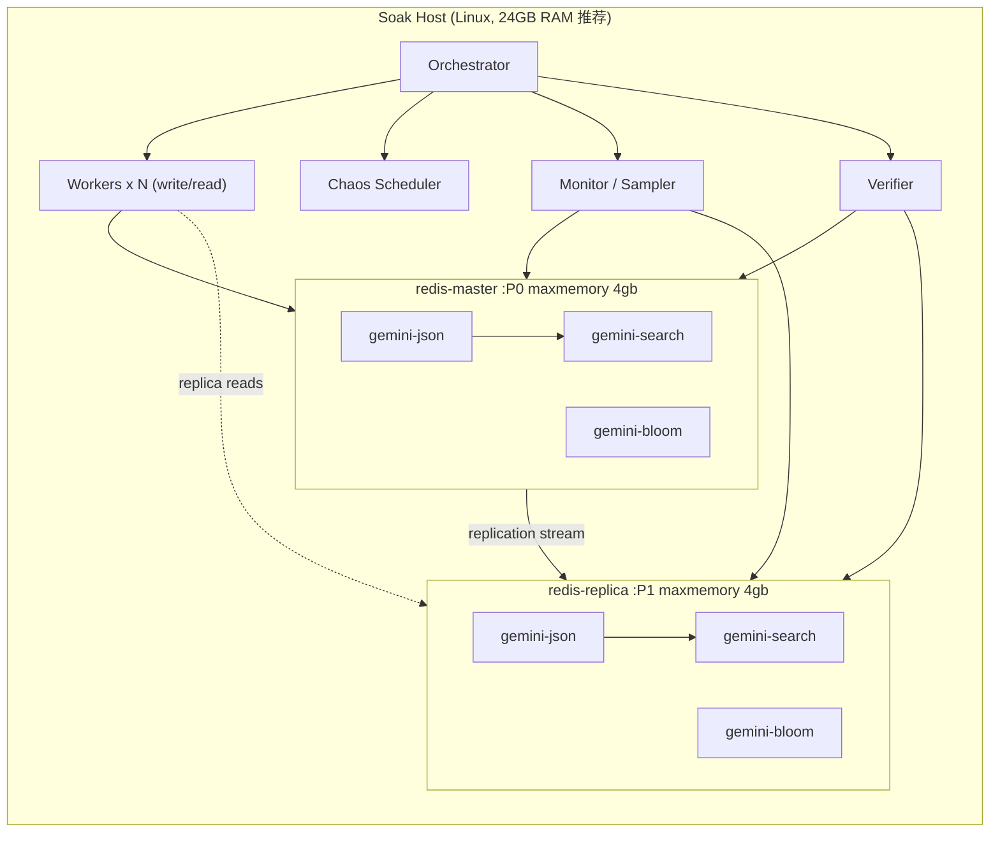
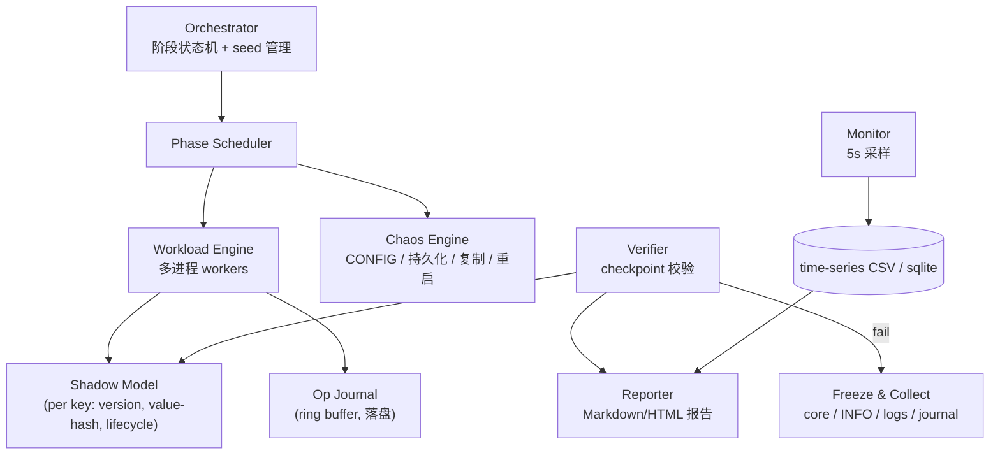
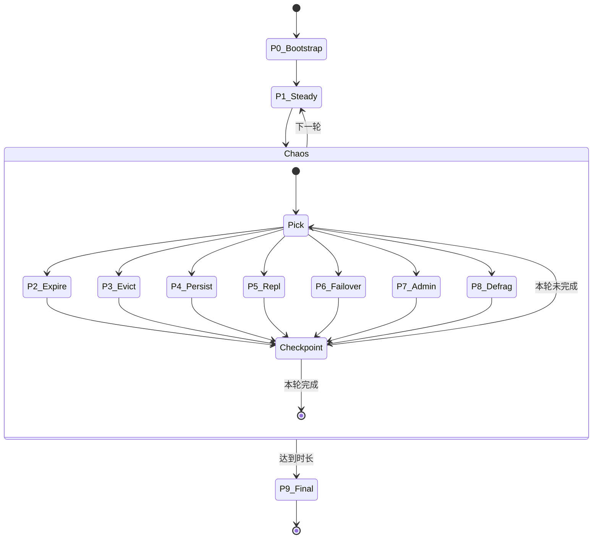

# Gemini Full-Stack Soak Test 设计文档

> 状态：草案 v0.1 · 适用版本：Redis 7.2.x + gemini-bloom / gemini-json / gemini-search（同进程挂载）
> 目标读者：soak 框架实现者、三个 module 的维护者

---

## 1. 背景与目标

现有 `ci/*_soak_test.py` 为**单模块、单实例、单连接、30s～300s** 的短时冒烟，无法发现：

- 慢速内存泄漏、碎片累积、长期运行后的性能退化
- 内存逼近 `maxmemory` 时的**淘汰**路径、**过期**路径与 module 回调（free / free_effort / unlink / 通知）的交互
- 主备复制、持久化（RDB/AOF/fork）、failover 与 module 状态（尤其 search 索引）的一致性
- 三个 module 在同一进程中的**交叉影响**（json → search 的 module notification 联动、共享内存预算、共享 bio 线程）
- 多客户端并发 + search 后台查询线程（`SearchExecutor` + `BlockClient`）与主线程删除/淘汰之间的竞态

### 1.1 目标

| # | 目标 |
|---|------|
| G1 | 在 **4GB maxmemory 主备**拓扑上，三 module 同时加载，连续运行 **≥24h**（可配置到 72h），零崩溃、零数据损坏 |
| G2 | 覆盖淘汰（8 种策略全覆盖）、过期（主动/惰性/批量/复制侧）、持久化、复制、failover、管理命令等边界场景 |
| G3 | 每个场景都有**可机器判定的不变式（oracle）**，失败时可复现（固定 seed + 操作日志） |
| G4 | 输出内存/延迟/复制时间序列，能判定"无泄漏、无持续退化" |
| G5 | 同一套框架支持 **mini 模式**（1GB / 1h）用于 PR 门禁、**full 模式**（4GB / 24h+）用于 nightly/发版 |

### 1.2 非目标

- 不做性能基准（已有 `run_benchmarks.sh`），只做性能**退化检测**
- 不覆盖 Redis Cluster 多分片（已有 `search_cluster_soak_test.py`，后续可作为扩展 §12）
- 不与 RedisStack 做结果比对（已有 compat 测试）

---

## 2. 测试拓扑



### 2.1 实例配置（master / replica 相同，差异项标注）

```conf
# --- 内存 ---
maxmemory               4gb
maxmemory-policy        volatile-lru        # 运行时由 Chaos 阶段轮换
maxmemory-samples       5                   # 部分阶段改为 10
maxmemory-eviction-tenacity 10              # 阶段内会调到 100 测"激进淘汰"
replica-ignore-maxmemory yes                # 默认值；单独阶段测 no
activedefrag            yes
active-defrag-ignore-bytes 100mb
active-defrag-threshold-lower 10
# --- lazyfree（让 module value 的释放进入 bio 线程，重点验证 free 回调线程安全）---
lazyfree-lazy-eviction  yes
lazyfree-lazy-expire    yes
lazyfree-lazy-server-del yes
lazyfree-lazy-user-del  yes
lazyfree-lazy-user-flush yes
replica-lazy-flush      yes
# --- 持久化 ---
appendonly              yes
appendfsync             everysec
aof-use-rdb-preamble    yes
auto-aof-rewrite-percentage 100
auto-aof-rewrite-min-size   512mb
save                    "3600 1 300 100000"
# --- 复制 ---
repl-backlog-size       256mb
repl-diskless-sync      yes                 # 阶段内在 yes/no 之间切换
repl-diskless-load      disabled            # 阶段内切换 swapdb / on-empty-db
client-output-buffer-limit replica 1gb 512mb 60
# --- 其它 ---
hz                      10                  # 阶段内调到 100 观察主动过期/定时器压力
latency-monitor-threshold 50
slowlog-log-slower-than 10000
loadmodule /path/redis_json.so
loadmodule /path/redis_bloom.so
loadmodule /path/redis_search.so          # 必须在 json 之后，依赖 JSON module notification
```

> [!IMPORTANT]
> 主机内存预算：master 4GB + master fork COW 最坏 4GB（BGSAVE / AOF rewrite / diskless 全量同步期间高写入）+ replica 4GB + replica 自身 AOF rewrite 的 COW（与 master fork 错开调度，按 2GB 估算）+ harness 影子模型约 2GB ≈ **16GB 下限，推荐 24GB**（harness 放在另一台机器时可降到 16GB）。另需 `vm.overcommit_memory=1`、关闭 THP、SSD 用于 AOF/RDB。macOS 只支持 mini 模式。
>
> Chaos 调度约束：**同一时刻最多一个 fork**（master BGSAVE、master AOF rewrite、replica AOF rewrite 互斥），由 Orchestrator 在触发前检查 `rdb_bgsave_in_progress` / `aof_rewrite_in_progress`，并临时关闭 auto-aof-rewrite / save 以避免自动触发与手动注入撞车。

### 2.2 构建变体

| 变体 | maxmemory | 用途 |
|------|-----------|------|
| release (jemalloc) | 4GB | 主力 full 模式 |
| release (libc malloc) | 4GB | 验证 `used_memory` 统计与碎片行为差异（activedefrag 不可用，相关断言跳过） |
| ASan + UBSan | 1GB | mini 模式，捕获 UAF / 越界（ASan 内存放大约 2～3x） |
| TSan（可选） | 256MB | 专门跑 §5.4 / §5.6 的竞态场景 |

---

## 3. Harness 架构



### 3.1 组件职责

- **Orchestrator**：拉起/重启实例、管理 seed（全局 seed → 每阶段/每 worker 派生子 seed）、驱动阶段状态机、汇总退出码。
- **Workload Engine**：`N` 个 worker 进程（默认 32，含 4 个 replica 只读 worker），每个 worker 负责一段**不重叠的 key 分区**，以便本地维护精确影子模型，避免跨进程锁。支持 pipeline（深度 1～64 随机）与 QPS 限速。
- **Shadow Model**：每个 key 记录 `{module, class, version, value_digest, ttl_deadline, last_write_ts}`；大对象只存摘要（xxhash），并允许按需重新生成完整期望值（值由 `seed+key+version` 可确定性重建）。
- **Chaos Engine**：按阶段注入 §5 的事件。
- **Verifier**：周期性 checkpoint（见 §6.2），比对影子模型、主备一致性、索引一致性。
- **Monitor**：采样 `INFO ALL`、`MEMORY STATS`、`LATENCY LATEST`、`SLOWLOG`、`FT.INFO`、`/proc/<pid>/status`（RSS/VmHWM）、CPU，写入时间序列。
- **Freeze & Collect**：任一不变式失败 → 停止 worker、`CLIENT PAUSE ALL`、保存 `INFO`/`DEBUG` 输出、日志、core、最近 100k 条操作日志与 seed，**保留实例不退出**（可配置），供事后排查。

### 3.2 Key 命名与生命周期分类

所有 key 形如 `<module>:<class>:<worker>:<id>`，class 决定可接受的语义：

| class | 说明 | TTL | 期望语义 |
|-------|------|-----|----------|
| `gold` | 黄金数据，约占数据量 25% | 无 | **必须精确存在且等于影子值**（allkeys-* 淘汰阶段除外，§5.3） |
| `vol` | 易失数据，约占 35% | 1s～6h 随机 | **不存在，或等于最新写入值**；不允许出现旧版本或损坏值 |
| `evc` | 可淘汰填充数据，约占 30% | 部分有 TTL | 同 `vol` |
| `noise` | 原生 Redis 类型（string/list/zset/hash 非索引前缀），约占 10% | 混合 | 与 module key 竞争淘汰；只检查不损坏 |

每个 module 值内嵌**版本号**，用来判断"是最新值还是旧值/损坏值"：
- JSON：根对象 `"_v": <int>`、`"_k": "<key>"`
- HASH（search 索引用）：字段 `_v`、`_k`
- Bloom 家族：无法内嵌，改用"版本号编码进成员名"（如 `item@v17`），并依赖"无假阴性"不变式
- TDigest / CMS / TopK：由影子模型保存已注入的数据集摘要，检查统计上的不变式（§4）

---

## 4. 工作负载设计

### 4.1 数据量预算（full 模式，目标常态占用约 70%，即 ~2.8GB）

> [!NOTE]
> search 的索引结构（倒排、HNSW 图、numeric tree）计入 `used_memory` 但**不能被淘汰**。预算中索引数据按"原始数据 × 1.5"估算，P0 结束后用实测值校准各类别规模，确保 key 数据 + 索引在 70% 左右。

| 类别 | 占比 | 规模（约） | 备注 |
|------|------|-----------|------|
| JSON（不被索引） | 15% | 150k 文档 | 1KB 为主，1% 为 64KB～4MB 大文档，0.1% 为 128 层深嵌套 |
| JSON（被 search 索引） | 15% | 150k 文档 | 前缀 `jidx:` |
| HASH（被 search 索引） | 15% | 500k 文档 | 前缀 `hidx:`；TEXT/TAG/NUMERIC/GEO/VECTOR |
| HNSW 向量 | 10% | 100k × dim 128 FLOAT32 | 另有 FLAT 小索引作为召回率 baseline |
| Bloom/Cuckoo | 15% | 25k 小过滤器 + 8 个 32MB～256MB 大过滤器 | 大过滤器用于测"大 key 淘汰/lazyfree" |
| CMS/TopK/TDigest | 10% | 各 10k | |
| noise | 10% | — | |
| 余量 | 10% | — | 保留给 fork COW 之外的缓冲 |

### 4.2 gemini-bloom

覆盖命令：BF.* / CF.* / CMS.* / TOPK.* / TDIGEST.* 全部（含 SCANDUMP / LOADCHUNK）。

| 场景 | 不变式 |
|------|--------|
| 可扩展 BF 持续写入，跨多次 expansion | 已写入成员**零假阴性**；`BF.CARD == BF.INFO Items`；实测误判率 ≤ 2× 配置值（每 checkpoint 用 10k 个未写入成员抽样） |
| NONSCALING 写满 | 返回 "filter is full" 错误，之后的读请求正常 |
| CF ADD/ADDNX/DEL/COUNT 混合（成员可重复） | 未删除成员零假阴性；`CF.COUNT ≥ 影子计数`（允许指纹碰撞导致偏大） |
| CMS INCRBY + MERGE（含自身别名 + WEIGHTS） | `QUERY ≥ 真实计数`；误差 ≤ ε·N（概率界） |
| TopK 有重度热点的 Zipf 流 | 真实 top-k 中频次远高于第 k+1 名的元素必须出现在 `TOPK.LIST` |
| TDigest 长期 ADD + RESET + MERGE | QUANTILE 单调；`MIN/MAX` 精确；`CDF(MAX)=1`；相对误差在阈值内 |
| SCANDUMP → LOADCHUNK 克隆（可能遇到源 key 被并发淘汰/过期） | 克隆完成后行为与源一致；源在中途消失时返回明确错误，不崩溃、不产生半成品 key（或半成品 key 可被安全 DEL） |

### 4.3 gemini-json

覆盖命令：JSON.* 全部（含 MSET/MGET/MERGE/ARRPOP/ARRINSERT/STRAPPEND/TOGGLE/NUMMULTBY/CLEAR/RESP/DEBUG），路径同时覆盖 legacy（`.a.b`）与 JSONPath（`$..x`、过滤表达式、通配符、负下标）。

| 场景 | 不变式 |
|------|--------|
| 随机变更 + 影子模型 | `gold` 精确相等；`vol/evc` 不存在或等于最新版本 |
| 大文档（4MB）反复 `JSON.SET $` 整体替换 | 内存回落到基线 ±5%；整体替换不阻塞主线程超过阈值 |
| 深嵌套（128 层）+ 递归路径 `$..` | 不栈溢出；结果与影子一致 |
| 数值边界：int64 溢出、NaN/Inf 拒绝、浮点精度 | 与 RedisJSON 语义一致（参考 compat 测试） |
| `JSON.DEBUG MEMORY` vs `MEMORY USAGE` | 两者偏差 ≤ 20%（mem_usage 准确与否会影响运维判断与 `MEMORY USAGE` 结果） |
| MULTI/EXEC、Lua `redis.call('JSON.SET')`、FUNCTION 中调用 | 主备结果一致（ReplicateVerbatim 在脚本中的效果复制正确） |

### 4.4 gemini-search

索引集合（启动时创建，运行中还会 DROP / 重建 / ALTER）：

| 索引 | ON | Schema |
|------|----|--------|
| `idx_h` | HASH `hidx:` | TEXT(PHONETIC, WEIGHT) / TAG(SEPARATOR, CASESENSITIVE) / NUMERIC SORTABLE / GEO / GEOSHAPE |
| `idx_j` | JSON `jidx:` | `$.title` TEXT / `$.tags[*]` TAG / `$.price` NUMERIC / `$.loc` GEO |
| `idx_v` | HASH `vec:` | VECTOR HNSW dim128 L2/COSINE + TAG 过滤 |
| `idx_vflat` | HASH `vec:` | VECTOR FLAT（同一数据，作为召回率基准） |
| `idx_tmp_*` | 随机 | 生命周期短的索引，持续 CREATE/DROPINDEX [DD] |
| 别名 `alias_live` | — | 在 `idx_h` / `idx_h2` 间 ALIASUPDATE 切换 |

查询组合：FT.SEARCH（TEXT/TAG/NUMERIC 范围/GEO/否定/可选/前缀/模糊/SORTBY/RETURN/HIGHLIGHT/SUMMARIZE/LIMIT 深分页）、FT.AGGREGATE（GROUPBY/REDUCE/APPLY/FILTER/SORTBY + WITHCURSOR + MAXIDLE）、FT.HYBRID、KNN（带过滤）、FT.PROFILE、FT.EXPLAIN、FT.SPELLCHECK、FT.TAGVALS、FT.SUG*、FT.DICT*、FT.SYN*。

| 场景 | 不变式 |
|------|--------|
| HASH/JSON 写入 → 索引联动 | checkpoint 时（§6.2 静默窗口）`FT.SEARCH idx * LIMIT 0 0` 的总数 == `SCAN MATCH prefix TYPE hash/ReJSON` 计数；抽样 1000 个 doc 的字段值与影子一致 |
| TAG / NUMERIC 精确查询 | 结果集合 == 影子模型过滤结果（静默窗口内） |
| KNN | 对 200 个随机查询，HNSW recall@10 相对 FLAT ≥ 0.95；对已删除/过期/被淘汰的向量**永不返回** |
| 游标长期持有 + 期间数据删除/过期/淘汰 | `FT.CURSOR READ` 不崩溃；返回的 doc 要么仍存在，要么被安全跳过；过期游标返回明确错误 |
| CREATE 时已有大量存量数据（initial scan）且扫描过程中持续写入/删除 | 扫描结束后满足总数不变式 |
| `FT.ALTER` 加字段 + 并发写入 | ALTER 后新字段可查询，存量文档被正确回填 |
| `FT.DROPINDEX DD` + 并发写同前缀 | 不崩溃；DD 删除后同前缀新写入不再进入已删除的索引 |

---

## 5. 场景阶段（Phase）设计

整体运行时间线：`P0 初始化 → [P1 → 随机排列(P2…P8)] × K 轮 → P9 收尾`。每个阶段结束后都做一次**全量 checkpoint**，每轮结束后做一次**内存基线采样**（§6.3）。



### 5.1 P0 初始化 & P1 稳态

- P0：按 §4.1 预算灌数据到 ~60%；创建全部索引（一部分在灌数据**前**创建，一部分在**后**创建，以同时覆盖增量索引与 initial scan 两条路径）。
- P1（每轮 30～60min）：混合读写，读:写 = 7:3，各 module 流量按数据占比分配；replica worker 持续执行只读查询。

### 5.2 P2 过期（Expiration）

| 子场景 | 操作 | 关注点 / 不变式 |
|--------|------|----------------|
| E1 主动过期风暴 | 在 1s 窗口内让 500k 个 key（三种 module 类型混合）同时到期；`hz` 分别为 10 / 100 | active expire cycle 不导致延迟尖刺 > 阈值（参考 `latency-monitor`）；`expired_keys` 计数正确；search 收到 `expired` 通知后从索引中移除文档 |
| E2 惰性过期 | 大量 key 到期后立刻用 `FT.SEARCH` / `FT.AGGREGATE` / `JSON.GET` / `BF.EXISTS` **直接访问** | **严格断言**（对标 RediSearch 2.10+ / Redis 8）：访问已逻辑过期的 key 一律视为不存在；**`FT.SEARCH` / `FT.AGGREGATE` 不得返回已逻辑过期但尚未物理删除的文档** |
| E3 TTL 变更 | EXPIRE / PEXPIRE / EXPIREAT / PERSIST / `EXPIRE … NX/XX/GT/LT`、`SET … KEEPTTL` 类比（对 module key 再 JSON.SET 是否保留 TTL） | module 写命令后 TTL 保持语义与原生类型一致（JSON.SET 不清除 TTL）；PERSIST 后 key 不再过期 |
| E4 过期 + 大 value | 让 256MB 的 BF、4MB 的 JSON 过期（`lazyfree-lazy-expire yes`） | 释放走 bio 线程（free_effort2 > 阈值）；主线程无阻塞；**module free 回调在 bio 线程中执行时不访问共享可变状态**（ASan/TSan 变体中重点观察） |
| E5 复制侧过期 | replica 上读取 master 上已过期但 DEL 尚未传播的 key | **严格断言**（对标 RediSearch 2.10+ / Redis 8）：replica 上 `JSON.GET` / `BF.EXISTS` 返回空，且 **`FT.SEARCH` / `FT.AGGREGATE` 同样不得返回已逻辑过期的文档** |
| E6 过期 + 游标 | AGGREGATE WITHCURSOR 期间结果集中的 key 大量过期 | 游标继续读不崩溃，结果不包含已删除 doc 的脏字段 |
| E7 索引同名 key 隔离 | 确认索引不在 keyspace 中：对与索引同名的 key 执行 `EXISTS` / `EXPIRE` / `DEL` / `SET` | 索引不受任何影响；`SET <idx_name> foo` 正常写入用户 string key，之后 `DEL <idx_name>` 或 `FT.DROPINDEX <idx_name>` 互不干扰 |
| E8 MULTI 中过期 | MULTI 中 `JSON.SET` + `EXPIRE 0`/`PEXPIRE 1` | 主备一致；search 索引最终无该文档 |

### 5.3 P3 内存压力与淘汰（Eviction）

**驱动方式**：持续以高写入速率灌 `evc` 数据，使 `used_memory` 顶到 4GB 并保持 ≥ 10 分钟；或通过 `CONFIG SET maxmemory 3gb` **瞬时下调** 触发淘汰风暴，之后再恢复。

**策略轮换**：每个子阶段一个策略，全部 8 种都覆盖：

| 策略 | 期望 |
|------|------|
| `noeviction` | 带 `deny-oom` 标志的写命令（JSON.SET、BF.ADD、FT.CREATE、FT.ADD、CMS.INCRBY…）返回 `-OOM`；**只读命令（FT.SEARCH、JSON.GET、BF.EXISTS、TDIGEST.QUANTILE…）照常可用**；DEL/UNLINK/FT.DROPINDEX 仍可执行以释放内存。重点检查各命令注册的 flags 是否正确（写命令漏标 `deny-oom` 会导致超限） |
| `volatile-lru/lfu/ttl/random` | 只有带 TTL 的 key 被淘汰 → `gold` 必须**全部完好**（这是该阶段最强的断言） |
| `allkeys-lru/lfu/random` | 所有 key 都可能被淘汰，`gold` 降级为"不存在或等于最新值"；**search 索引定义不在 keyspace 中，绝不能被淘汰** |

**淘汰阶段不变式**：

1. `used_memory` 在淘汰稳定期 ≤ `maxmemory × 1.02`（允许单条命令超出的瞬时值，记录最大超出量）
2. `evicted_keys` 单调递增，主库每淘汰一个 key 都向 replica 传播 DEL → checkpoint 时主备 `DBSIZE` 一致
3. search 收到 `evicted` 通知后，checkpoint 时索引 doc 数 == keyspace 中对应前缀的 key 数（无"孤儿文档"）
4. 被淘汰的向量不再出现在 KNN 结果中
5. **索引本身的内存**（倒排、HNSW 图、numeric tree）不在 keyspace 中，无法被淘汰 → 需观测：持续淘汰后索引内存是否随 doc 删除而回收（`FT.INFO` 的内存字段 vs doc 数比例应稳定）
6. 大 key 淘汰（256MB BF）走 lazyfree，`latency-monitor` 中 `eviction-del` 事件 < 阈值
7. LFU 策略下，热点 key（Zipf 头部）保留率显著高于冷 key（统计断言，防止 `OBJECT FREQ` 对 module key 不更新）
8. `maxmemory-eviction-tenacity 100` + 大批量写入时，不出现主线程长时间卡在淘汰循环（客户端超时）

**附加子场景**：

- EV-A：`replica-ignore-maxmemory no` 时 replica 自己淘汰导致主备分歧 —— 这是 Redis 的预期行为，记录并验证 module 不崩溃，此子阶段结束后强制全量同步恢复一致
- EV-B：fork 期间（BGSAVE 进行中）触发淘汰 + COW 增长，观察 RSS 峰值是否 < 物理内存安全线
- EV-C：module 统计的内存与实际不一致的检测 —— 对每类 module key 抽样，`MEMORY USAGE` 汇总值 vs 删除这批 key 前后的 `used_memory` 差值，偏差 > 30% 报警（淘汰依赖 `used_memory`，但运维依赖 `MEMORY USAGE`）

### 5.4 P4 持久化

| 子场景 | 操作 | 不变式 |
|--------|------|--------|
| PS1 BGSAVE 带写入 | 高写入下 `BGSAVE`，完成后用临时实例加载该 RDB | 加载成功；临时实例的 `DEBUG DIGEST` == 该 RDB 对应时刻主库快照（通过在 BGSAVE 开始瞬间 `CLIENT PAUSE WRITE` + 记录 digest 实现） |
| PS2 BGREWRITEAOF | 高写入下重写 AOF（三 module 的 `aof_rewrite` 回调） | 用重写后的 AOF 启动临时实例，`DEBUG DIGEST` 一致；search 索引在 AOF 回放后可用、doc 数一致 |
| PS3 DEBUG RELOAD | 主库 `DEBUG RELOAD` | 前后 digest 相同；search `Loading` 事件处理正确，索引重建后查询结果一致 |
| PS4 冷重启（RDB） | `SHUTDOWN SAVE` → 用 RDB 启动 | 同上 + 重启耗时记录 |
| PS5 冷重启（AOF） | `SHUTDOWN` → appendonly yes 启动 | 同上 |
| PS6 kill -9 | 随机时刻 `kill -9` master，用 AOF 恢复 | 最多丢失 everysec 窗口内的写；已确认（被 `WAIT 1` 或 fsync 覆盖）的写不得丢失；无损坏 |
| PS7 截断 / 损坏 AOF | 截断最后一条记录 | `aof-load-truncated yes` 时能启动；module `HANDLE_IO_ERRORS` 路径不崩溃 |
| PS8 DUMP / RESTORE | 对每类 module key DUMP → RESTORE 到新名字（含 `REPLACE`、`ABSTTL`、`IDLETIME`、`FREQ`） | 值相等；RESTORE 到 search 前缀时被索引 |
| PS9 RDB 跨版本 | 用上一发布版本 module 生成的 RDB 启动当前版本 | encver 兼容（参考 `kJsonEncVer*`、`kSearchEncVer`） |

### 5.5 P5 复制

| 子场景 | 操作 | 不变式 |
|--------|------|--------|
| RP1 全量同步（磁盘） | `repl-diskless-sync no`，replica `REPLICAOF NO ONE` → 再 `REPLICAOF` | 同步完成后 digest 一致；replica search 索引 doc 数一致 |
| RP2 全量同步（diskless） | `repl-diskless-sync yes` + `repl-diskless-load swapdb` / `on-empty-db` | 同上；swapdb 模式下加载期间 replica 上的旧数据读请求不崩溃，search 不出现两份索引状态混淆 |
| RP3 部分同步 | `CLIENT KILL TYPE replica`（backlog 内） | `sync_partial_ok` +1、`sync_full` 不增加；digest 一致 |
| RP4 backlog 溢出 | 断开期间写入 > 256MB | 退化为全量同步，最终一致 |
| RP5 replica 读压力 | 4 个 worker 持续在 replica 上 FT.SEARCH / JSON.GET / BF.EXISTS，同时 replica 进行全量同步加载 | 加载期间返回 `-LOADING` 或旧数据，不崩溃 |
| RP6 复制延迟 | 主库 4GB 满载写入 | `master_repl_offset - slave_repl_offset` 的 P99 < 阈值（例如 64MB）且最终收敛 |
| RP7 脚本 / 事务复制 | Lua、FUNCTION、MULTI 中混合三种 module 命令 + 非确定性分支 | digest 一致（effects replication） |
| RP8 module 内部的 `RedisModule_Replicate` 路径 | bloom（CMS/TopK 内部改写复制）、search（FT.ADD 等）对应命令高频执行 | 主备逐 key `DEBUG DIGEST-VALUE` 抽样一致 |

### 5.6 P6 Failover / 角色切换

- FO1：`FAILOVER`（Redis 7 原生协调切换）主备互换，worker 自动重连新主
- FO2：强制切换：replica `REPLICAOF NO ONE`，旧主 `REPLICAOF new_master`
- FO3：旧主 kill -9 后提升 replica，旧主恢复后以 replica 身份重新加入（触发全量同步，需丢弃分叉数据）
- 断言：
  - 切换后新主上 search 索引可写可查、doc 数与 keyspace 一致
  - 游标在新主上明确失效（返回错误而不是崩溃或错误结果）
  - 新主上的 TTL 正确继续计时（replica 上 key 带有绝对过期时间）
  - 切换前已被 `WAIT 1` 确认的写全部存在

### 5.7 P7 管理命令与 keyspace 操作

| 子场景 | 操作 | 关注点 |
|--------|------|--------|
| AD1 FLUSHDB / FLUSHALL [ASYNC] | 在业务高峰执行（只在专用 db 或阶段末执行，执行后重新灌数据） | search `FlushDB` 事件后全部索引清空/失效语义一致；ASYNC 时 module value 在 bio 线程释放 |
| AD2 SWAPDB / SELECT / MOVE | 把带索引前缀的 key MOVE 到其它 db；SWAPDB 0 1 | 索引只跟踪 db0（或明确的语义），不残留 doc |
| AD3 RENAME / RENAMENX | 把 `hidx:a` RENAME 为 `hidx:b`、`other:c`，以及反向 | 旧名从索引删除；新名若匹配前缀则被索引 |
| AD4 COPY | 对三种 module key `COPY src dst [REPLACE]`（copy2 回调） | 深拷贝：修改 dst 不影响 src；dst 匹配前缀时被索引 |
| AD5 DEL / UNLINK 大 key | UNLINK 256MB BF、4MB JSON、超大 HASH | free_effort2 决定是否进入 bio；主线程无阻塞 |
| AD6 OBJECT / MEMORY / TYPE / SCAN TYPE | 对 module key 执行 | 不崩溃，返回合理 |
| AD7 CLIENT PAUSE WRITE / ALL | 在过期、淘汰进行中暂停 | 暂停期间不发生主动过期/淘汰（Redis 7 语义），search 定时器回调不违反暂停 |
| AD8 CONFIG SET 热变更 | maxmemory、policy、hz、activedefrag、lazyfree-* 运行时切换 | 立即生效且不崩溃 |
| AD9 DEBUG SLEEP / 慢命令 | 主线程卡住 5s | search 后台线程、定时器、复制心跳恢复正常 |
| AD10 MODULE LIST / FT.CONFIG / FT._LIST / FT._DEBUG | 定期调用 | 不崩溃 |
| AD11 索引同名 key 操作 | 对与索引同名的 key 执行 `SET idx_h foo`、`DEL idx_h`、`RENAME idx_h other`、`FT.DROPINDEX` | 索引定义与同名用户 key 完全隔离，互不影响 |
| AD12 client 断开 | 在 BlockClient 查询（search 后台线程执行中）执行时 `CLIENT KILL` 该连接 | 无 UAF；后台线程结果被安全丢弃 |

### 5.8 P8 碎片整理与内存回收

- 制造碎片：先灌入大量小 JSON/小 BF，再随机删除 50%，然后写入不同尺寸的数据
- `activedefrag yes`，观察 `mem_fragmentation_ratio` 与 `active_defrag_hits`
- 断言：
  - 三个 module 的 defrag 回调执行期间与执行之后数据不损坏（defrag 后立即做抽样 digest）
  - 碎片率在 defrag 后下降（jemalloc 变体）
  - `MEMORY PURGE` 后 RSS 下降
  - defrag 与 search 后台查询线程并发时没有 UAF（ASan/TSan 变体）

### 5.9 P9 收尾

1. 停止所有 worker，等待复制收敛
2. 全量 checkpoint（不是抽样，而是全部 key）
3. 主备 `DEBUG DIGEST` 比对
4. 删除全部 `vol/evc/noise` 数据 → 等待 lazyfree 完成（`lazyfree_pending_objects == 0`）→ 记录基线内存，与 P0 结束时的基线对比
5. `FT.DROPINDEX` 全部索引 → 记录内存，检查索引内存是否全部回收
6. `FLUSHALL` → `used_memory` 应回到"空库 + module 静态开销"水平（±阈值）
7. `SHUTDOWN`，检查日志中没有 `WARNING` / `# Bug report` / ASan 报告

---

## 6. 不变式与判定（Oracle）

### 6.1 不变式总表

| ID | 类别 | 不变式 | 检查频率 |
|----|------|--------|----------|
| I1 | 存活 | 主/备进程存活，无 `# Bug report`、无 core | 5s |
| I2 | 错误 | worker 收到的错误 ∈ 白名单（OOM、LOADING、预期的 WRONGTYPE / 不存在等）；白名单之外任何错误立刻失败 | 每次操作 |
| I3 | 数据 | `gold` 精确相等（allkeys-* 阶段除外） | checkpoint |
| I4 | 数据 | `vol/evc` 不存在或等于最新值（不得出现旧版本） | 读操作 + checkpoint |
| I5 | 复制 | 主备 `DEBUG DIGEST` 相同（静默窗口内） | checkpoint |
| I6 | 索引 | 每个索引的 doc 数 == 对应前缀与类型的 key 数；抽样字段与影子一致 | checkpoint |
| I7 | 索引 | KNN 不返回已删除 key；HNSW recall@10 ≥ 0.95 | checkpoint |
| I8 | 概率结构 | BF/CF 零假阴性；误判率在界内；CMS 不低估；TDigest 误差在界内 | 读操作 + checkpoint |
| I9 | 内存 | 淘汰稳定期 `used_memory ≤ maxmemory × 1.02` | 5s |
| I10 | 内存 | 每轮基线内存的线性回归斜率 < 阈值（例如 < 5MB/h）| 每轮 |
| I11 | 内存 | `mem_fragmentation_ratio` < 1.5（jemalloc，排除 fork 期间） | 5s |
| I12 | 延迟 | 各命令族 P99 < 阈值；`latency-monitor` 中事件 max < 阈值（例如 eviction-del < 50ms、expire-cycle < 100ms） | 5s |
| I13 | 延迟退化 | 同一阶段第 N 轮的 P99 / 第 1 轮的 P99 < 1.5 | 每轮 |
| I14 | 复制 | 非 chaos 阶段 `sync_full` 不增加；复制延迟有界 | 5s |
| I15 | 持久化 | 每份 RDB/AOF 都能加载，且 digest 一致 | P4 |
| I16 | 日志 | 结束时 server 日志中没有非预期的 WARNING | P9 |

### 6.2 静默窗口（Quiesced Checkpoint）

在有并发写、过期、淘汰的情况下，很多不变式（I5/I6）在任意时刻都无法精确成立。做法：

1. Orchestrator 通知 worker 暂停 → 等待在途请求清空
2. 主库 `CLIENT PAUSE <timeout> WRITE`（Redis 7 中这会同时暂停主动过期和淘汰）
3. 等待 `master_repl_offset == replica offset`，并等待 search 异步索引队列清空（需要一个可观测指标，比如 `FT.INFO` 中的 indexing / pending 字段，见 §11 Q4）
4. 执行校验（全量或抽样）
5. `CLIENT UNPAUSE`，恢复 worker

静默窗口耗时纳入报告；full 模式每 10min 做一次抽样 checkpoint，每个阶段结束做一次全量 checkpoint。

### 6.3 内存泄漏判定

- **基线定义**：每轮结束时，删除全部 `vol/evc/noise`，等待 `lazyfree_pending_objects == 0`，执行 `MEMORY PURGE`，然后取 `used_memory` 和 RSS
- 基线序列做线性回归；`slope > 阈值` 或 `R² > 0.8 且 slope > 0` → 判定疑似泄漏
- 同时按 module 拆分：分别只删除某一 module 的数据，看 `used_memory` 回落量是否与该 module key 的 `MEMORY USAGE` 合计相符
- 索引专项：每轮 DROP + 重建 `idx_tmp_*` 100 次，前后内存差 < 阈值

---

## 7. 监控与报告

### 7.1 采样指标（每 5s，主备各一份）

- `INFO memory`：used_memory、used_memory_rss、mem_fragmentation_ratio、lazyfree_pending_objects、mem_not_counted_for_evict
- `INFO stats`：expired_keys、evicted_keys、expired_stale_perc、total_eviction_exceeded_time、current_eviction_exceeded_time、instantaneous_ops_per_sec、active_defrag_*
- `INFO persistence`：rdb_*、aof_*、fork 耗时 latest_fork_usec、COW 大小
- `INFO replication`：offset、lag、sync_full、sync_partial_ok/err
- `INFO commandstats` / `latencystats`（Redis 7）：按命令的 P50/P99/P999
- `LATENCY LATEST`、`SLOWLOG GET`
- `FT.INFO` 每个索引：num_docs、内存字段、indexing 状态
- `/proc/<pid>/status`：VmRSS、VmHWM；CPU 使用率；线程数（检测线程泄漏）
- 客户端侧：每个命令族的延迟直方图（HdrHistogram）、错误计数

### 7.2 报告

- 生成 `report.md` + `metrics.sqlite`（或 CSV），内容包括：阶段时间线、每个不变式的 PASS/FAIL、内存/延迟/复制延迟曲线（可用 mermaid xychart 或生成 PNG）、每轮基线回归结果、top slowlog、错误分布
- 失败时额外附上：seed、失败前最近 N 条操作、失败瞬间的 INFO 快照、core 路径、复现命令

---

## 8. 运行模式与参数

| 参数 | mini（PR 门禁） | 4g1h（快速 4G 验收） | full（nightly） | marathon（发版前） |
|------|----------------|---------------------|----------------|-------------------|
| maxmemory | 1GB | 4GB | 4GB | 4GB |
| 时长 | 1h | 1h | 24h | 72h |
| workers | 8 | 16 | 32 | 32 |
| 轮数 K | 2 | ~2–3 | ~12 | ~36 |
| 阶段子集 | P1/P2/P3/P4(PS3)/P5(RP3) | 全部 | 全部 | 全部 + PS9 + TSan 变体 |
| 构建 | ASan | release | release | release + ASan(1GB) 并行 |

主要配置项：`--seed`、`--duration`、`--maxmemory`、`--phases`、`--phase-weights`、`--scale`、`--workers`、`--keep-on-fail`、`--build-variant`、`--report-dir`。

复现方式：`--seed S --phases P3 --start-from-snapshot <rdb>`（每个阶段开始前可选择保存 RDB 快照，用于快速回放）。

---

## 9. 目录结构建议

```text
ci/soak_full/
  orchestrator.py        # 入口，阶段状态机
  topology.py            # 拉起/重启 master+replica，配置模板
  conf/redis.conf.tmpl
  workload/
    bloom_wl.py  json_wl.py  search_wl.py  noise_wl.py
  shadow/model.py        # 影子模型与确定性值生成
  chaos/
    expire.py evict.py persist.py repl.py failover.py admin.py defrag.py
  verify/
    checkpoint.py digest.py index_consistency.py prob_invariants.py
  monitor/sampler.py
  report/render.py
```

技术选型建议：Python 3.11 + redis-py（RESP2/RESP3 都要覆盖，worker 按比例分配）+ multiprocessing；延迟统计用 hdrhistogram；向量召回率用 numpy 暴力计算。

---

## 10. 分期实施计划

| 里程碑 | 内容 | 产出 |
|--------|------|------|
| M1 | 拓扑 + 三 module 加载 + P0/P1 + 影子模型 + I1–I6 + 监控 | 能稳定跑 mini 模式 |
| M2 | P2 过期 + P3 淘汰（8 种策略）+ I8–I12 | 覆盖用户最关心的边界 |
| M3 | P4 持久化 + P5 复制 + P6 failover + I14–I15 | full 模式 24h |
| M4 | P7 管理命令 + P8 defrag + 内存泄漏回归（§6.3）+ 报告 | nightly 接入 |
| M5 | ASan/TSan 变体、PS9 跨版本、marathon 模式 | 发版门禁 |

---

## 11. 需要 module 维护者先确认的语义问题（含开源 RediSearch 2.x 行为对比）

设计里有几处需要先定好"正确行为是什么"，否则断言没法写。前 3 项附上开源 RediSearch 2.x 的行为与当前 `gemini-search` 实现的差异供参考：

| # | 问题 | 开源 RediSearch 2.x 行为 | 当前 `gemini-search` 现状与风险 | 涉及场景 |
|---|------|--------------------------|-------------------------------|----------|
| Q1 | key 已逻辑过期但尚未被物理删除时，`FT.SEARCH` 是否允许返回它？ | RediSearch 2.x 早期（< 2.10）可能返回已逻辑过期的文档或导致 `total_results` 偏高；**Redis 8 / RediSearch 2.10+** 在查询/游标读取开始时过滤已过期文档。 | **已修复**（按严格断言实现）：`DocumentStore` 跟踪每个文档的绝对过期时间戳（经由 `expire`/`persist` 通知、索引写入及 RDB 加载后刷新维护），`FT.SEARCH` / `FT.AGGREGATE` / `FT.HYBRID` / KNN 同步及异步查询期按当前时间过滤已逻辑过期文档。 | E2 |
| Q2 | replica 上 key 已逻辑过期、但 master 的 DEL 尚未传播时，replica 上 `FT.SEARCH` 的预期结果是什么？ | Redis 8 / RediSearch 2.10+ 在 replica 查询期同样按 TTL 过滤已过期文档。 | **已修复**（按严格断言实现，同 Q1）：主库复制 `PEXPIREAT`/`PERSIST` 到备库时备库同步记录 `expire_at_ms`，即使主库 DEL 尚未传播，备库 `FT.SEARCH`/`FT.AGGREGATE` 也会立即过滤掉已逻辑过期文档。 | E5 |
| Q3 | standalone 模式下，索引是否会因 `allkeys-*` 淘汰 / `DEL` / `EXPIRE` / `SET` 同名 key 被破坏？ | **RediSearch 2.x 已彻底将索引移出 keyspace**，索引定义通过 **RDB aux data** 持久化，`KEYS *` 看不到索引，`DEL idx` 无效，也**不会被 `allkeys-*` 淘汰**。 | **已修复**：Standalone 模式已统一改为 RDB AUX（`kSearchAuxEncVer = 3`）持久化，不再写入 keyspace 锚点 key；`FT.DROPINDEX` 仅在遇到旧版 RDB 的 `GmSearch-` key 时才清理，绝不误删同名用户 key。 | E7、P3、AD11 |
| Q4 | search 的异步索引（timer 驱动的 initial scan / JSON 恢复）是否有可观测的"已完成/待处理数"指标？静默窗口需要它 | `FT.INFO` 提供 `indexing`（0/1）和 `percent_indexed` | 需确认 `FT.INFO` 字段是否已完整覆盖 initial scan 与 JSON 异步恢复 | §6.2 |
| Q5 | 各 module 的 `free` 回调在 lazyfree（bio 线程）中执行是否安全？ | RediSearch 2.x 索引不在 keyspace 中，不走 key 的 lazyfree；document key 的删除通过主线程 keyspace notification 处理 | **已修复**：Standalone 索引不再是 keyspace key，不会触发 `FreeSearch` 进入 bio 线程；同时 `search_rdb.cc` 中所有 `GetIndexEntry` 裸指针已全部改为 `GetIndexEntryShared` + 加锁，兼容加载旧版 RDB 时也无 UAF 风险。bloom/json 的 `free` 回调仅释放自身对象。 | E4、AD5 |
| Q6 | 所有写命令是否都注册了 `write deny-oom`？只读命令是否都注册了 `readonly`？（会影响 `noeviction` 阶段和 replica 读） | 写命令标 `write deny-oom`，读命令标 `readonly` | 待核查三个 module 全部命令 flags | P3 noeviction |
| Q7 | `JSON.SET` / `BF.ADD` 等命令对已有 TTL 的 key 是否保留 TTL？ | RedisJSON / RedisBloom 默认保留已有 TTL | 待确认三个 module 一致性 | E3 |
| Q8 | `JSON.DEBUG MEMORY` / `MEMORY USAGE` 允许的统计误差是多少？ | 估算值，允许一定偏差 | 需定下 soak 报警阈值（当前草案 30%） | EV-C |
| Q9 | 游标（`FT.CURSOR`）在 failover、`DEBUG RELOAD`、`FLUSHDB` 之后的预期行为 | 游标纯内存态，重启/切换/FLUSH 后失效并返回错误 | 待确认 `FT.CURSOR READ` 返回明确错误而非崩溃 | E6、FO、AD1 |

---

## 12. 后续扩展

- 1 主 2 从 + Sentinel 自动故障转移
- 3 分片 Cluster 版本（结合已有 `search_cluster_soak_test.py`，增加 slot 迁移 + 淘汰 + 过期的组合）
- 网络故障注入（tc netem 延迟/丢包，toxiproxy 断链）
- 磁盘故障注入（AOF 写满磁盘 → `-MISCONF` 路径）
- 模块热操作：`MODULE UNLOAD`（预期被拒绝）、使用不同模块参数重启（如 json `COMPAT` 模式切换后加载旧 RDB）
